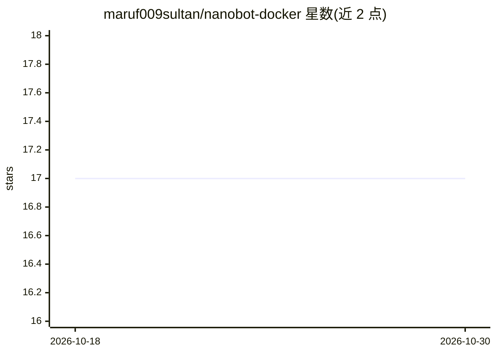

# maruf009sultan/nanobot-docker

⭐ 17 · Dockerfile · MIT · 推送 2026-07-18 · [GitHub](https://github.com/maruf009sultan/nanobot-docker) · [官网](https://github.com/HKUDS/nanobot) · 个人维护

**nanobot（openclaws 替代）的非交互式 Docker 部署方法（非官方）**

仓库 README 仅含标题一行，具体内容需以下方仓库描述为据：提供一种非交互式的 Docker 部署方法，用于部署 openclaws 的替代品 nanobot，标注为非官方（unofficial）。主题标签涉及 agents、ai-agent、api、docker、free 等。README 内未给出安装命令、配置说明或使用文档，无法核实具体部署步骤与依赖。

## 筛选速览

| 维度 | 判定 | 备注 |
|---|---|---|
| AI 角色 | `ai-ecosystem` | LLM/agent 周边工具 |
| 许可风险 | `permissive` | MIT |
| 部署形态 | `None` |  |
| 模型依赖 | — | README 未给出锁定关系 |
| 硬件要求 | — | 无带数字的原话,不猜 |
| 安装摩擦 | `low` | 无编译、无系统依赖或容器化 |
| 成熟度 | — | 结构信号不足 |

## 能力要点

- 提供 nanobot 的非交互式 Docker 部署方法
- 标注为非官方（unofficial）仓库

## 适用场景

- 通过 Docker 部署 nanobot agent
- 寻找 openclaws 的替代部署途径

## 场景标签

 · 领域:AI agent 部署工具

## 证据(README 行号)

> L1: # nanobot-docker

## 星数曲线

2026-10-18 17 → 2026-10-30 17（+0）

---
*卡片 v1 · prompt 1.4 · 生成 2026-10-29 · 置信度 low · 依据 README sha `b3045d69b704` · [字段定义](../../DATASET.md)*
