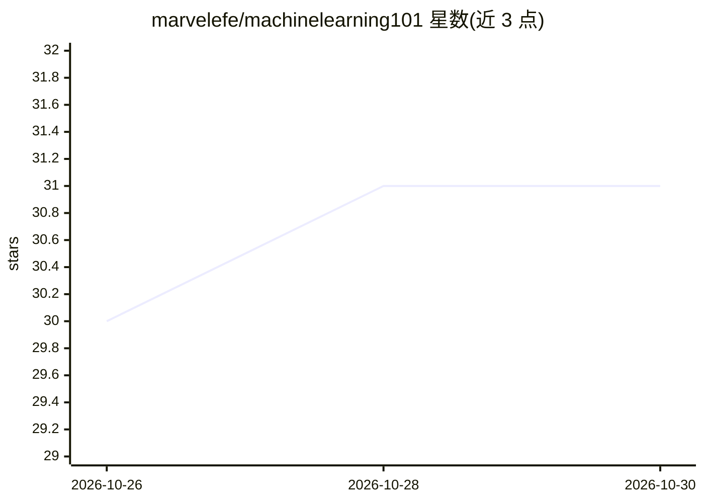

# marvelefe/machinelearning101

⭐ 31 · TypeScript · MIT · 推送 2026-10-21 · [GitHub](https://github.com/marvelefe/machinelearning101) · [官网](https://machinelearning101.com) · 个人维护

**浏览器内交互式机器学习入门教学平台**

基于 Nuxt 4 + TypeScript 构建的开源教学网站，面向机器学习初学者：通过拖拽数据点、调节参数等交互实验帮助建立对算法的直觉，覆盖回归、分类、聚类、预处理、优化与神经网络等主题。全部在客户端运行，无需安装与后端，进度保存在浏览器本地，可选登录后通过 Cloudflare Workers + D1 跨设备同步。网站为纯静态生成，可部署到任意静态主机。本地开发需 Node.js 22+ 与 npm 10+。

## 筛选速览

| 维度 | 判定 | 备注 |
|---|---|---|
| AI 角色 | `ai-knowledge` | 知识聚合/清单类 |
| 许可风险 | `permissive` | MIT |
| 部署形态 | `None` |  |
| 模型依赖 | — | README 未给出锁定关系 |
| 硬件要求 | — | 无带数字的原话,不猜 |
| 安装摩擦 | `low` | 无编译、无系统依赖或容器化 |
| 成熟度 | — | 结构信号不足 |

## 能力要点

- 全客户端运行，零安装、无后端依赖、无需注册
- Chart.js/D3.js/Plotly.js 驱动的交互式 2D/3D 可视化
- 覆盖 6 大学习域：回归/分类/聚类/预处理/优化/进阶（PCA、t-SNE、神经网络）
- 纯静态站点生成，可部署到 Netlify/Vercel/GitHub Pages

## 适用场景

- 初学者在浏览器中动手调节参数理解梯度下降、K-means 等算法
- 通过交互图表与测验系统学习机器学习基础概念
-  educators 或贡献者按模块创建指南添加新的学习模块

## 场景标签

`教程课程` · 领域:学习与行业

## 证据(README 行号)

> L19: Machine Learning 101 is a free, browser-based platform for building intuition about machine learning.
> L30: - 🎯 **Interactive learning** — Real-time parameter adjustments with immediate visual feedback

## 星数曲线

2026-10-26 30 → 2026-10-30 31（+1）

---
*卡片 v1 · prompt 1.4 · 生成 2026-10-26 · 置信度 high · 依据 README sha `ec664ee5ab4b` · [字段定义](../../DATASET.md)*
