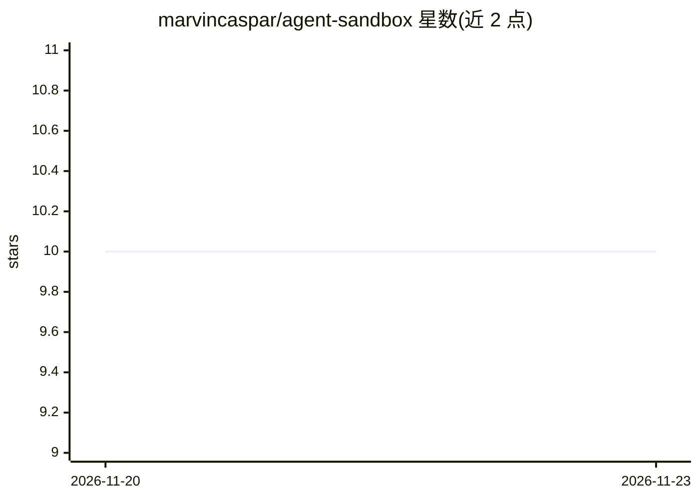

# marvincaspar/agent-sandbox

⭐ 10 · Shell · 推送 2026-11-20 · [GitHub](https://github.com/marvincaspar/agent-sandbox) · 个人维护

**在隔离 Docker 容器中运行 AI 编码代理的安全沙箱**

为终端 AI 编码代理（pi、opencode）提供容器化运行环境的包装工具：每个代理由独立目录中的 Dockerfile 与 bash 包装脚本驱动，首次运行自动构建多阶段镜像（基于 Chainguard node 镜像，含 go/php8.5 变体）。容器以宿主 UID 非 root 运行，丢弃全部 Linux capabilities 并禁止提权，代理无 Docker socket 访问权。可选启动 tinyproxy 代理 sidecar，按域名白名单强制过滤出站流量；另支持 Jira MCP 的 OAuth 密钥文件转发。

## 筛选速览

| 维度 | 判定 | 备注 |
|---|---|---|
| AI 角色 | `ai-ecosystem` | LLM/agent 周边工具 |
| 许可风险 | `none` | — |
| 部署形态 | `self-host` | docker 或自建部署 |
| 模型依赖 | — | README 未给出锁定关系 |
| 硬件要求 | — | 无带数字的原话,不猜 |
| 安装摩擦 | `low` | 无编译、无系统依赖或容器化 |
| 成熟度 | — | 结构信号不足 |

## 能力要点

- 非 root 容器 + 全 capabilities 丢弃 + no-new-privileges 的安全模型
- 可选代理 sidecar：域名白名单、默认拒绝、仅放行 HTTP/HTTPS 端口
- 支持 base/go/php8.5 多个镜像变体
- 工作目录绑定挂载，容器内代理可直接读写宿主文件

## 适用场景

- 在本机安全运行 AI 编码代理而不放开权限
- 限制编码代理的出站网络访问范围
- 隔离环境中连接宿主机 MySQL 等服务进行开发

## 场景标签

`编码 Agent` · 领域:编码与开发

## 证据(README 行号)

> L3: Runs AI coding agents inside isolated Docker containers. Agents get no root access, no Docker socket, and no ability
> L84: Each agent lives in its own directory with a `Dockerfile` and a bash wrapper script. The wrapper:
> L87: 2. Starts a proxy sidecar container and an isolated internal Docker network

## 星数曲线

2026-11-20 10 → 2026-11-23 10（+0）

---
*卡片 v1 · prompt 1.4 · 生成 2026-11-20 · 置信度 high · 依据 README sha `3876900d2815` · [字段定义](../../DATASET.md)*
