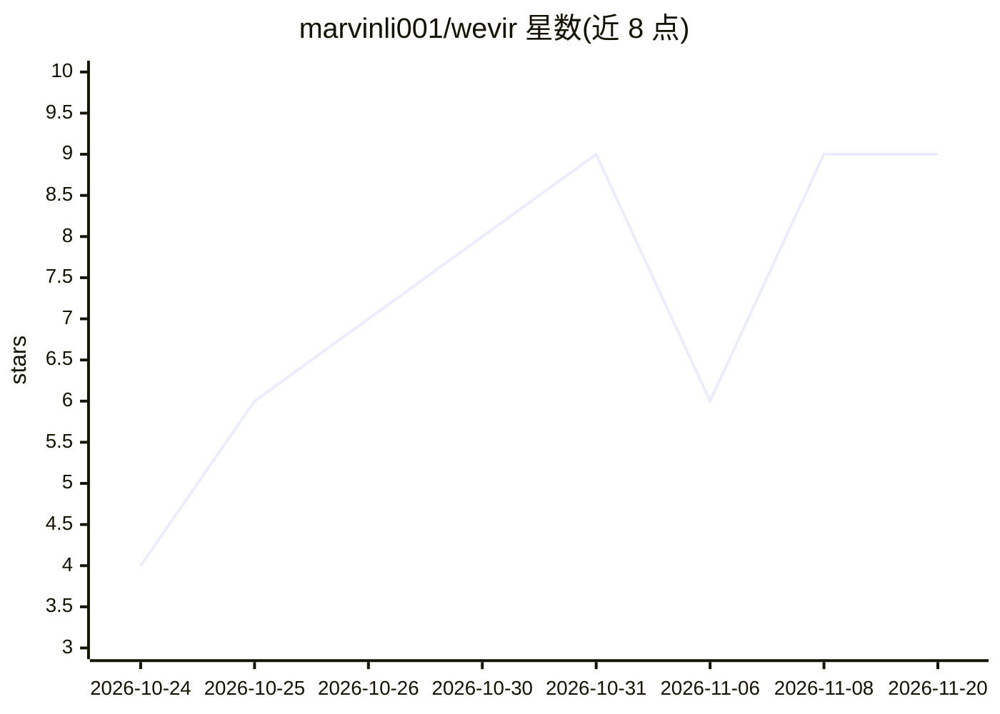

# marvinli001/wevir

⭐ 9 · TypeScript · MIT · 推送 2026-11-18 · [GitHub](https://github.com/marvinli001/wevir) · [官网](https://wevir.si) · 个人维护 · 中文 README

**本地优先桌面工作区：统一运行多个 AI 编码 agent**

Wevir 是开源、本地优先的 agent 工作区，可在同一界面并排运行 Codex、Claude Code 等 AI 编码 agent。本地 Host 持有会话时间线、模型网关、各引擎与数据，支持自有 API key、任意 OpenAI 兼容端点及现有订阅（多账号）。关键机制包括跨引擎会话移交、用量限额后换模型续跑、跨引擎共享项目记忆、二次评审与逐轮检查。安装方式为 DMG/EXE/AppImage/deb/APK 及独立 CLI；Linux、Intel macOS、Windows 为 Beta 状态，订阅源依赖各厂商客户端。

## 筛选速览

| 维度 | 判定 | 备注 |
|---|---|---|
| AI 角色 | `ai-ecosystem` | LLM/agent 周边工具 |
| 许可风险 | `permissive` | MIT |
| 部署形态 | `library` | 以包/库形式分发 |
| 模型依赖 | local-ok | 支持本地模型 |
| 硬件要求 | — | 无带数字的原话,不猜 |
| 安装摩擦 | `low` | 无编译、无系统依赖或容器化 |
| 成熟度 | — | 结构信号不足 |

## 能力要点

- 本地 Host 管理会话时间线、模型网关与密钥隔离（密钥不传入 agent 进程）
- 同一会话内跨引擎/跨模型切换与 handoff 交接简报
- 网关将请求转换为 OpenAI Responses、Chat Completions 或 Anthropic Messages 格式
- 桌面应用、CLI、Web 客户端与手机 app 连接同一 Host

## 适用场景

- 在统一界面管理 Codex、Claude Code 等多个编码 agent 与多账号订阅
- 在会话中按任务切换不同模型或本地 Ollama
- 用量限额时自动切换到另一模型继续当前回合
- 通过手机 app 远程查看会话并审批操作

## 场景标签

`模型网关` `编码 Agent` · 领域:Agent 开发

## 证据(README 行号)

> L19: **Wevir is an open-source, local-first agent workspace that runs Codex, Claude Code, and other coding agents side b
> L32: - **Model per task, not per app.** The open-source Codex agent runtime runs locally; Wevir's gateway translates its
> L21: A local Host owns the session timeline, the model gateway, every engine, and the data on your machine. Because thes

## 星数曲线

2026-10-24 4 → 2026-11-20 9（+5）

---
*卡片 v1 · prompt 1.4 · 生成 2026-11-20 · 置信度 mid · 依据 README sha `e849bc056031` · [字段定义](../../DATASET.md)*
