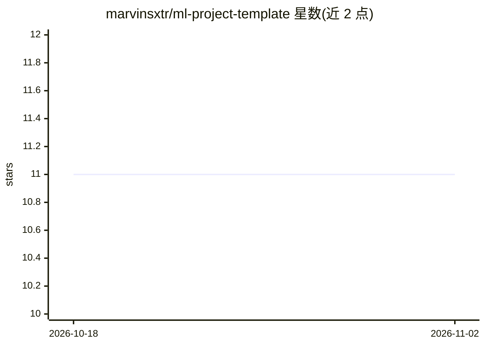

# marvinsxtr/ml-project-template

⭐ 11 · Python · MIT · 推送 2026-07-07 · [GitHub](https://github.com/marvinsxtr/ml-project-template) · 个人维护

**Slurm 集群上做 ML 实验的项目模板（wandb/hydra-zen/submitit）**

面向使用 Slurm 集群的机器学习研究者的项目模板：以 Docker/Apptainer 容器化 Python 3.12 环境（uv 管理依赖），集成 Weights & Biases 日志记录、hydra-zen 类型检查的可复现配置、通过 submitit 从 Python 直接提交 Slurm 作业与多节点参数扫描。实验函数通过添加 Run 参数并用 run 包装即可接入配置、日志与作业提交。针对 ML Group 集群环境优化，需 GitHub token 拉取 ghcr.io 镜像，集群作业强制启用 WandB。

## 筛选速览

| 维度 | 判定 | 备注 |
|---|---|---|
| AI 角色 | `ai-ecosystem` | LLM/agent 周边工具 |
| 许可风险 | `permissive` | MIT |
| 部署形态 | `self-host` | docker 或自建部署 |
| 模型依赖 | — | README 未给出锁定关系 |
| 硬件要求 | — | 无带数字的原话,不猜 |
| 安装摩擦 | `low` | 无编译、无系统依赖或容器化 |
| 成熟度 | — | 结构信号不足 |

## 能力要点

- Docker/Apptainer 容器化，无需 .def 或 .sh 文件
- submitit 从 Python 提交 Slurm 单作业与多节点分布式扫描
- hydra-zen 生成可复现的 config.yaml，WandB 记录实验
- uv 管理 Python 依赖，GitHub Actions 自动构建新镜像

## 适用场景

- 在 Slurm 集群上搭建可复现的 ML 实验环境
- 从 Python 脚本直接提交 Slurm 作业和参数扫描
- 用 WandB 跟踪实验并用配置文件复现历史运行

## 场景标签

`MLOps` · 领域:训练与推理

## 证据(README 行号)

> L3: A modern template for machine learning experimentation using **wandb**, **hydra-zen**, and **submitit** on a Slurm c
> L18: - 🖥️ Submit Slurm jobs and parameter sweeps directly from Python via submitit

## 星数曲线

2026-10-18 11 → 2026-11-02 11（+0）

---
*卡片 v1 · prompt 1.4 · 生成 2026-11-02 · 置信度 mid · 依据 README sha `2d789b5cd353` · [字段定义](../../DATASET.md)*
