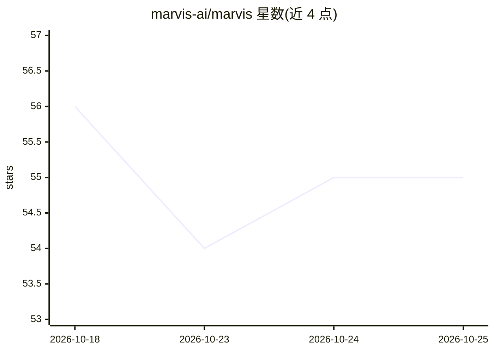

# marvis-ai/marvis

⭐ 55 · Rust · Apache-2.0 · 推送 2026-10-12 · [GitHub](https://github.com/marvis-ai/marvis) · [官网](https://getmarvis.com) · 组织维护

**桌面端隐私优先 AI 副驾：看屏幕、听会议、本地存储**

基于 Tauri 2 + Rust + React 的桌面悬浮助手，以常驻小条形式提供屏幕问答（截图进内存环形缓冲、不落盘）、双通道会议转写与滚动摘要、全局热键与深链。模型自带：OpenAI/Anthropic/Gemini/OpenRouter/Ollama 或 OpenAI 兼容端点，可组成拖拽排序的失败切换链。数据全部存于 ~/.marvis，keys.json 为明文（无加密）。通过 Bun + Rust 工具链从源码构建运行。

## 筛选速览

| 维度 | 判定 | 备注 |
|---|---|---|
| AI 角色 | `ai-native` | 本体是模型或模型工具 |
| 许可风险 | `permissive` | Apache-2.0 |
| 部署形态 | `None` |  |
| 模型依赖 | local-ok | 支持本地模型 |
| 硬件要求 | — | 无带数字的原话,不猜 |
| 安装摩擦 | `low` | 无编译、无系统依赖或容器化 |
| 成熟度 | — | 结构信号不足 |

## 能力要点

- 屏幕问答：截图仅存内存环形缓冲（约 60 秒，上限 120 帧/64MB），不写磁盘
- 双通道会议捕获（麦克风+系统音频）→ 流式转写 → 每 5 轮滚动摘要
- 多 provider 失败切换链，支持 Ollama 本地模型（无需 API key）
- STT 可选 Deepgram 或捆绑 whisper.cpp 旁路进程（模型按需下载）

## 适用场景

- 在桌面随时就当前屏幕内容向 AI 提问
- 本地录制并转写会议，生成滚动摘要
- 用本地 Ollama 模型避免数据出设备

## 场景标签

`AI 助手` `语音识别` · 领域:对话与助手

## 证据(README 行号)

> L16: Marvis is an always-available assistant that floats above your workspace as a
> L31: - **Ask** — type a question or press `Cmd`/`Ctrl+Enter`; Marvis grabs
> L32:  the latest screen frame, sends it with your prompt to your LLM, and

## 星数曲线

2026-10-18 56 → 2026-10-25 55（-1）

---
*卡片 v1 · prompt 1.4 · 生成 2026-10-24 · 置信度 high · 依据 README sha `5d0e8bcbb6a9` · [字段定义](../../DATASET.md)*
