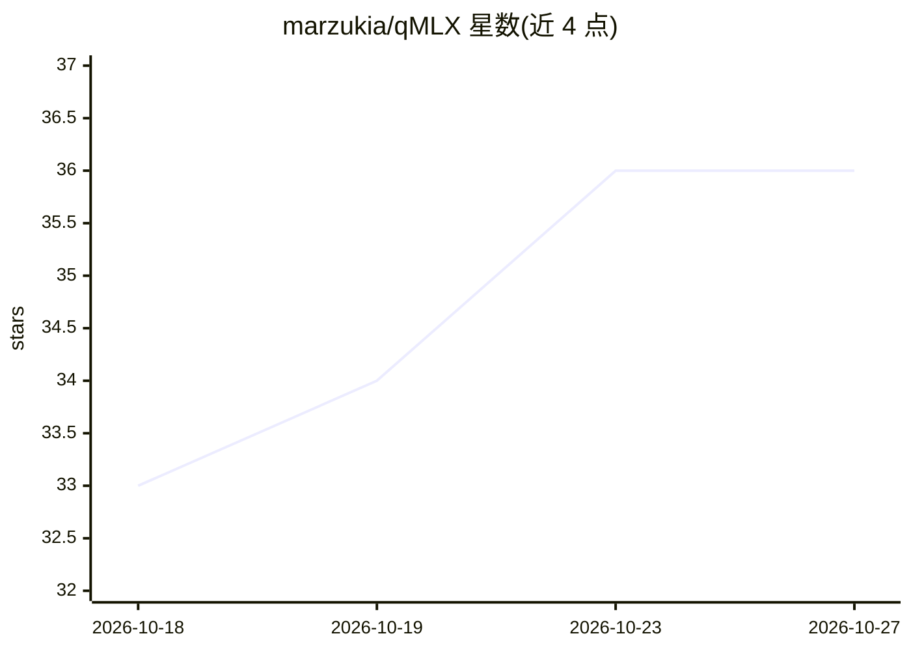

# marzukia/qMLX

⭐ 36 · Python · Apache-2.0 · 推送 2026-10-25 · [GitHub](https://github.com/marzukia/qMLX) · [官网](https://qmlx.mrzk.io) · 个人维护

**面向 Apple Silicon 的 Qwen3.5-122B 专用推理引擎，磁盘 KV 缓存复用**

基于 MLX 的推理引擎 fork（自 Rapid-MLX），专用于在 Apple Silicon（M3 Ultra 类、96GB+ 统一内存）上单用户长上下文服务 Qwen3.5-122B-A10B 混合 MoE 模型。核心机制：针对 DeltaNet 循环层无法回退的特点，移除内存前缀缓存，改为 SSD 上的 KV 检查点存储与恢复（默认 100 GiB、int4 检查点恢复时反量化）；提供 OpenAI/Anthropic API。状态为 Alpha，仅支持一个模型、`--max-num-seqs 1`，冷 prefill 中断会丢弃已计算内容。

## 筛选速览

| 维度 | 判定 | 备注 |
|---|---|---|
| AI 角色 | `ai-ecosystem` | LLM/agent 周边工具 |
| 许可风险 | `permissive` | Apache-2.0 |
| 部署形态 | `library` | 以包/库形式分发 |
| 模型依赖 | — | README 未给出锁定关系 |
| 硬件要求 | — | 无带数字的原话,不猜 |
| 安装摩擦 | `medium` | 含编译或系统依赖之一 |
| 成熟度 | `idea` | |

## 能力要点

- SSD 磁盘 KV 检查点与恢复作为唯一缓存层（M3 Ultra 上重复 32k 提示从 88s 降至 0.64s）
- 混合注意力/DeltaNet 显式分支处理与 matchable-aware 磁盘驱逐
- OpenAI/Anthropic 兼容 API
- 分阶段指标（decode tok/s、prefill 吞吐、磁盘恢复命中率、TTFT）与分歧定位日志

## 适用场景

- 在 Mac Studio 上长期运行 Qwen3.5-122B 的 agentic 编码对话
- 跨轮次长上下文（100k+ token）通过磁盘恢复避免重复 prefill
- 用 OpenAI/Anthropic 兼容客户端接入本地 Qwen 服务

## 场景标签

`推理引擎` · 领域:训练与推理

## 证据(README 行号)

> L9:  A Qwen-specialised fork of qMLX for long-context serving of hybrid MoE models on Apple Silicon.
> L71: qmlx serve mlx-community/Qwen3.5-122B-A10B-4bit \
> L104: Forked from raullenchai/Rapid-MLX. The base engine, the OpenAI/Anthropic API surface, and the MLX serving path are

## 星数曲线

2026-10-18 33 → 2026-10-27 36（+3）

---
*卡片 v1 · prompt 1.4 · 生成 2026-10-25 · 置信度 high · 依据 README sha `b411b4f4a41d` · [字段定义](../../DATASET.md)*
