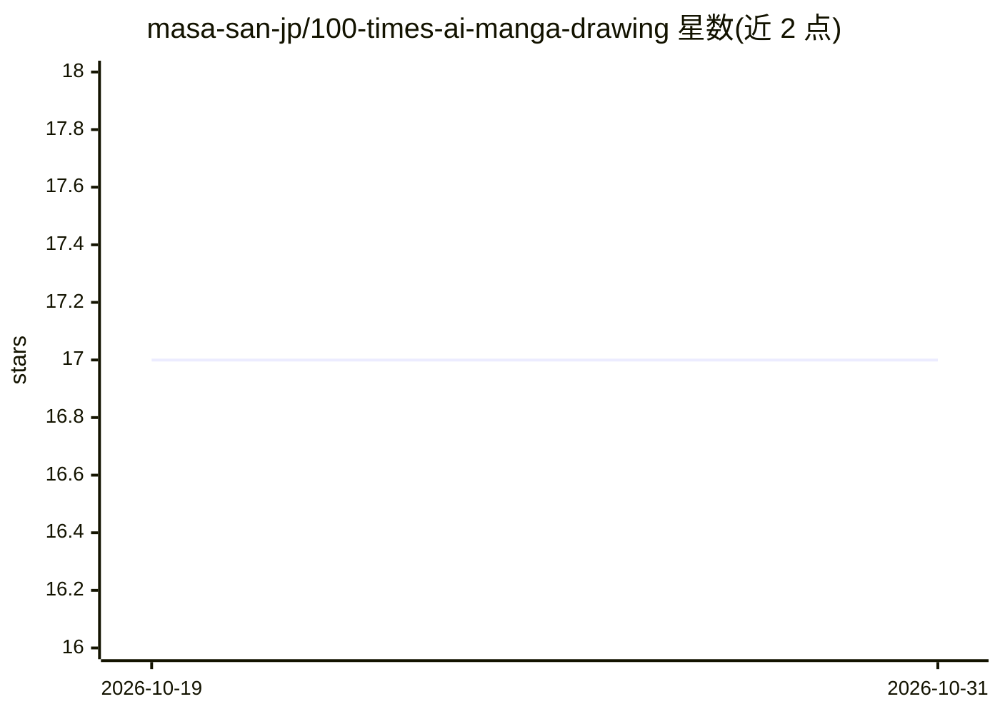

# masa-san-jp/100-times-ai-manga-drawing

⭐ 17 · Python · 推送 2026-10-23 · [GitHub](https://github.com/masa-san-jp/100-times-ai-manga-drawing) · 个人维护

**给漫画作者的本地应用：从草图与指示书批量生成漫画下稿**

本地运行的漫画作画辅助应用：用户上传角色草图、分镜（ネーム）与作画指示书，由 Gemini Nano Banana 2.1（Batch API）批量生成漫画页面下稿；支持按页面判定采用或需修正，仅对修改指示的页面重新生成，并保存采用图、却下候选与生成历史，可导出 PNG。仅支持 macOS/Linux、Python 3.12+、uv 与 Gemini API key（按图计费），目前仅支持黑白漫画，单机使用不支持多人同时访问。

## 筛选速览

| 维度 | 判定 | 备注 |
|---|---|---|
| AI 角色 | `ai-native` | 本体是模型或模型工具 |
| 许可风险 | `none` | — |
| 部署形态 | `None` |  |
| 模型依赖 | — | README 未给出锁定关系 |
| 硬件要求 | — | 无带数字的原话,不猜 |
| 安装摩擦 | `low` | 无编译、无系统依赖或容器化 |
| 成熟度 | — | 结构信号不足 |

## 能力要点

- 从草图生成角色设定图并用于后续作画
- 多页面批量生成，按页採用/需修正判定，仅重生成修正页
- 采用图/却下候选/生成历史保存，采用图 PNG 导出
- 基于 Gemini Nano Banana 2.1 Batch API

## 适用场景

- 用 AI 从草图和指示书批量产出漫画下稿
- 逐页审稿并只重画需要修改的页面
- 管理多部作品与连载的分镜资料和生成结果

## 场景标签

`图像生成` · 领域:内容生成

## 证据(README 行号)

> L3: キャラクタースケッチ、ネーム、作画指示書から、漫画の下書きをまとめて生成するローカルアプリです。ページごとに採用・要修正を判定し、指示を直したページだけ再生成できます。
> L108: - 作画モデルは **Gemini Nano Banana 2.1**。Batch APIを使うため、画像は依頼直後ではなく、処理完了後に表示されます。

## 星数曲线

2026-10-19 17 → 2026-10-31 17（+0）

---
*卡片 v1 · prompt 1.4 · 生成 2026-10-29 · 置信度 high · 依据 README sha `30cfce2cd258` · [字段定义](../../DATASET.md)*
