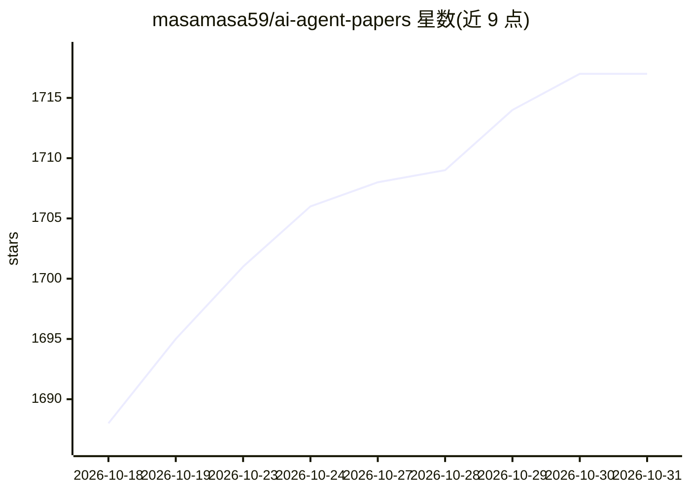

# masamasa59/ai-agent-papers

⭐ 1,717 · Python · 推送 2026-10-17 · [GitHub](https://github.com/masamasa59/ai-agent-papers) · 个人维护 · 中文 README

**AI Agent 研究论文精选清单，双周更新、按四层分类**

策展 AI Agent 研究论文的仓库：每周用特定关键词检索 arXiv，只收录方法上有新意的论文，不追求全面。论文按能力、架构、运行与交互、应用四层组织成带日期排序的阅读清单，并用 🔥/📖/⚖️ 标记推荐、综述与基准论文，徽章显示近两个月新增。另含 TAXONOMY.md 分类规则、月度趋势newsletter（日文，精读 arXiv HTML 并引用图表）与 highlights/ 目录的每月精选。

## 筛选速览

| 维度 | 判定 | 备注 |
|---|---|---|
| AI 角色 | `ai-knowledge` | 知识聚合/清单类 |
| 许可风险 | `none` | — |
| 部署形态 | `None` |  |
| 模型依赖 | — | README 未给出锁定关系 |
| 硬件要求 | — | 无带数字的原话,不猜 |
| 安装摩擦 | `low` | 无编译、无系统依赖或容器化 |
| 成熟度 | — | 结构信号不足 |

## 能力要点

- 每周关键词检索 arXiv，仅收录方法上有新意的论文
- 四层分类体系：能力/架构/运行与交互/应用
- 🔥推荐、📖综述、⚖️基准三类标记与近两月新增徽章
- 月度趋势 newsletter 与 highlights/ 每月精选存档

## 适用场景

- 按主题查找 AI Agent 最新研究论文的阅读清单
- 跟踪 Self-Evolution、Agent Evaluation 等热点方向的月度趋势
- 查找 Agent 领域的综述与基准论文

## 场景标签

`精选清单` `科研工具` · 领域:学习与行业

## 证据(README 行号)

> L3: This repository curates the latest research papers on the applications and architectural technologies of AI agents. 
> L15: Papers are filed in **four layers** — *capabilities* (what an agent can do), *architecture* (how it's built), *oper

## 星数曲线

2026-10-18 1,688 → 2026-10-31 1,717（+29）

---
*卡片 v1 · prompt 1.4 · 生成 2026-10-21 · 置信度 high · 依据 README sha `2d29961f647d` · [字段定义](../../DATASET.md)*
