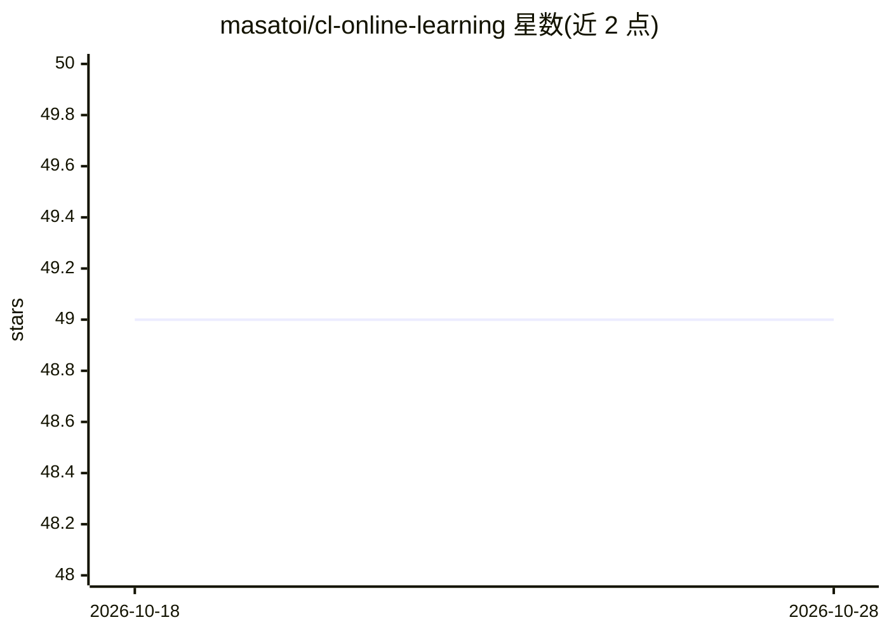

# masatoi/cl-online-learning

⭐ 49 · Common Lisp · MIT · 推送 2026-08-06 · [GitHub](https://github.com/masatoi/cl-online-learning) · 个人维护

**Common Lisp 编写的在线线性分类机器学习算法集**

用 Common Lisp 实现的在线线性分类算法库：二分类含 Perceptron、AROW、SCW-I、SGD/ADAM 逻辑回归与 FTRL-Proximal（L1 正则），多分类支持 one-vs-rest、one-vs-one、原生 multiclass AROW 与 softmax+FTRL-Proximal；另提供稀疏数据版本学习器与命令行工具（roswell 脚本）。数据以 LIBSVM 稀疏格式读入，提供训练、预测、测试与模型保存/恢复函数。经 Quicklisp 分发，MIT 许可。收敛性检验尚未实现（README 明示）。

## 筛选速览

| 维度 | 判定 | 备注 |
|---|---|---|
| AI 角色 | `ai-native` | 本体是模型或模型工具 |
| 许可风险 | `permissive` | MIT |
| 部署形态 | `None` |  |
| 模型依赖 | — | README 未给出锁定关系 |
| 硬件要求 | — | 无带数字的原话,不猜 |
| 安装摩擦 | `low` | 无编译、无系统依赖或容器化 |
| 成熟度 | — | 结构信号不足 |

## 能力要点

- 二分类算法：Perceptron/AROW/SCW-I/逻辑回归(SGD/ADAM)/FTRL-Proximal
- 多分类：one-vs-rest、one-vs-one、原生 multiclass AROW、softmax+FTRL-Proximal
- 稀疏数据版本学习器可处理高维特征（如 news20.binary）
- 支持 LIBSVM 格式读取与模型保存/恢复

## 适用场景

- 在 Common Lisp 项目中做在线二分类或多分类
- 处理 LIBSVM 格式的高维稀疏数据集
- 通过 roswell 脚本作为命令行分类工具使用

## 场景标签

 · 领域:机器学习库

## 证据(README 行号)

> L6: A collection of machine learning algorithms for online linear classification written in Common Lisp.
> L11: - Perceptron

## 星数曲线

2026-10-18 49 → 2026-10-28 49（+0）

---
*卡片 v1 · prompt 1.4 · 生成 2026-10-24 · 置信度 high · 依据 README sha `5d9b232137d6` · [字段定义](../../DATASET.md)*
