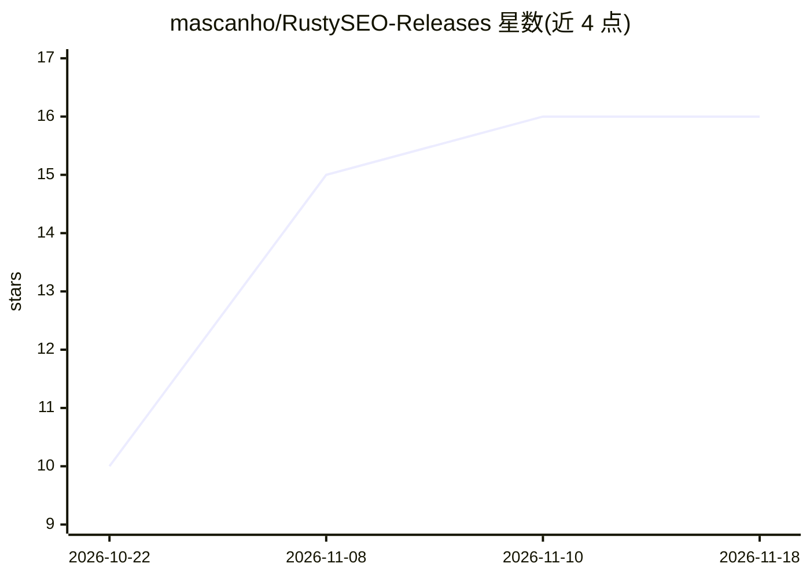

# mascanho/RustySEO-Releases

⭐ 16 · Apache-2.0 · 推送 2026-10-11 · [GitHub](https://github.com/mascanho/RustySEO-Releases) · [官网](https://rustyseo.com) · 个人维护

**面向 SEO/GEO 分析的跨平台桌面爬虫与日志分析工具，含 AI 功能**

基于 Tauri（Rust）+ Next.js/React 的本地桌面应用：爬虫引擎以 Rust 异步进程在本地运行，支持浅层/深度爬取、headless Chrome 渲染 SPA 页面、Apache/Nginx 日志分析、重复内容检测、两次爬取对比、PDF/CSV/Excel 报告导出，数据存储于本地 SQLite。AI 为可选功能：内置聊天机器人，可接 Google Gemini 或本地 Ollama（小模型本地 LLM 当前表现不佳）。面向做网站 SEO/GEO 分析的营销人员，免费提供，替代商业付费 SEO 工具。

## 筛选速览

| 维度 | 判定 | 备注 |
|---|---|---|
| AI 角色 | `ai-enhanced` | 去掉 AI 部分产品仍成立 |
| 许可风险 | `permissive` | Apache-2.0 |
| 部署形态 | `None` |  |
| 模型依赖 | local-ok | 支持本地模型 |
| 硬件要求 | — | 无带数字的原话,不猜 |
| 安装摩擦 | `low` | 无编译、无系统依赖或容器化 |
| 成熟度 | `idea` | |

## 能力要点

- Rust 本地异步爬虫引擎，自适应节流与并发，支持大站（>100K URL）
- headless Chrome 渲染 JS/SPA 页面
- Apache/Nginx 服务器日志分析与爬取对比（Diff Checker）
- 内置 AI 聊天机器人，可接 Google Gemini 或本地 Ollama

## 适用场景

- 我想不限页数地爬取并诊断整站 SEO 问题
- 分析 Apache/Nginx 日志获取搜索引擎抓取情况
- 生成 PDF/Excel 格式的网站爬取报告
- 通过内置 AI 聊天助手结合爬取上下文提问

## 场景标签

`网页抓取` `聊天机器人` · 领域:效率与自动化

## 证据(README 行号)

> L87: - Local LLM (Ollama);
> L89: - Built-in AI chatbot;
> L35: RustySEO is an all-in-one, cross-platform Marketing toolkit, designed for comprehensive SEO & GEO analysis. It enab

## 星数曲线

2026-10-22 10 → 2026-11-18 16（+6）

---
*卡片 v1 · prompt 1.4 · 生成 2026-11-18 · 置信度 high · 依据 README sha `48b6febeca3b` · [字段定义](../../DATASET.md)*
