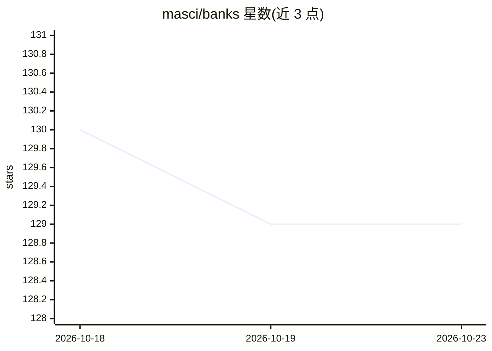

# masci/banks

⭐ 129 · Python · MIT · 推送 2026-09-10 · [GitHub](https://github.com/masci/banks) · [官网](https://masci.github.io/banks/) · 个人维护

**基于 Jinja 的 LLM 提示词模板语言与提示管理库**

Python 库，提供基于 Jinja 的模板语言来构建提示词文本与聊天消息，替代 f-string 方式。支持为提示词附加元数据、一等公民的版本管理、磁盘存储注册表（如 DirectoryTemplateRegistry）。通过 LiteLLM 驱动的 completion 扩展可在渲染时调用 LLM 生成内容，提供 tool 过滤器实现函数调用、Anthropic 提示缓存过滤器、图像注入视觉模型、asyncio 异步支持，以及可定制的生成缓存（默认内存缓存）。面向 LLM 应用开发者。

## 筛选速览

| 维度 | 判定 | 备注 |
|---|---|---|
| AI 角色 | `ai-ecosystem` | LLM/agent 周边工具 |
| 许可风险 | `permissive` | MIT |
| 部署形态 | `library` | 以包/库形式分发 |
| 模型依赖 | — | README 未给出锁定关系 |
| 硬件要求 | — | 无带数字的原话,不猜 |
| 安装摩擦 | `low` | 无编译、无系统依赖或容器化 |
| 成熟度 | — | 结构信号不足 |

## 能力要点

- 基于 Jinja 的提示词模板语言，渲染文本或聊天消息
- 提示词版本管理与元数据附加，磁盘注册表存储
- completion 扩展通过 LiteLLM 调用任意支持的模型提供商
- tool 过滤器与 Anthropic 提示缓存支持

## 适用场景

- 用模板替代 f-string 构建 LLM 提示词与聊天消息
- 在组织内统一存储、版本化和管理提示词
- 渲染时动态生成 few-shot 示例或执行函数调用

## 场景标签

`提示工程` · 领域:Agent 开发

## 证据(README 行号)

> L40: - :orange_book: **Templating**: Banks provides tools and functions to build prompts text and chat messages from gen
> L103: > The `completion` extension uses LiteLLM under the hood, and provided you have the

## 星数曲线

2026-10-18 130 → 2026-10-23 129（-1）

---
*卡片 v1 · prompt 1.4 · 生成 2026-10-23 · 置信度 high · 依据 README sha `5f68aaf62fc0` · [字段定义](../../DATASET.md)*
