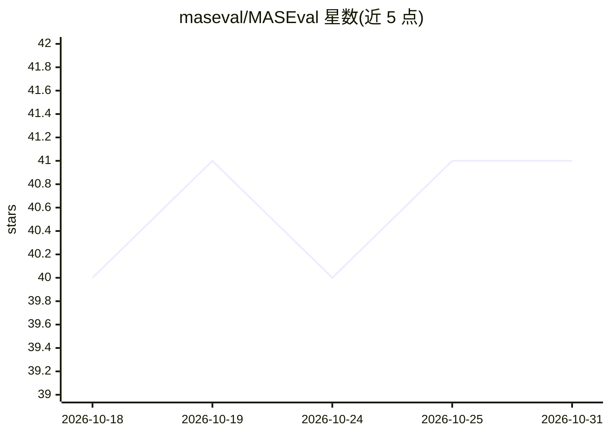

# maseval/MASEval

⭐ 41 · Python · MIT · 推送 2026-10-06 · [GitHub](https://github.com/maseval/MASEval) · [官网](https://maseval.github.io/MASEval/) · 组织维护

**多智能体系统评测基准框架：统一接口跑基准测试**

面向（多）智能体系统的评测基础设施库：通过适配器接入 smolagents、LangGraph、自定义框架或直接 API 调用实现的 agent，在 GAIA、MMLU 等内置基准或自定义任务上运行评测；负责编排评测生命周期（setup/执行/测量/teardown）并提供回调钩子用于追踪、日志与指标收集。不实现 agent 本身、不定义通信协议；追踪/日志/指标以可插拔回调后端实现（如 WandB、Langfuse）。需 Python 3.10+，PyPI 发布为 maseval，提供框架与基准的 extras 安装项。

## 筛选速览

| 维度 | 判定 | 备注 |
|---|---|---|
| AI 角色 | `ai-ecosystem` | LLM/agent 周边工具 |
| 许可风险 | `permissive` | MIT |
| 部署形态 | `library` | 以包/库形式分发 |
| 模型依赖 | — | README 未给出锁定关系 |
| 硬件要求 | — | 无带数字的原话,不猜 |
| 安装摩擦 | `low` | 无编译、无系统依赖或容器化 |
| 成熟度 | — | 结构信号不足 |

## 能力要点

- 适配器包装任意框架实现的 agent 系统，框架无关评测
- 内置 GAIA、MMLU 等基准与用户自定义任务
- 生命周期回调钩子支持追踪、日志、指标的可插拔后端
- 以完整系统为评测单元，支持跨架构对等比较

## 适用场景

- 跨框架对比不同多智能体架构在同一基准上的表现
- 为自研 agent 系统搭建标准化基准评测流程
- 通过回调接入自有日志/追踪后端收集评测数据

## 场景标签

`模型评测` · 领域:评测与运维

## 证据(README 行号)

> L13: MASEval is an evaluation library that provides a unified interface for benchmarking (multi-)agent systems. It is ev
> L15: Analogous to pytest for testing or MLflow for ML experimentation, MASEval focuses exclusively on evaluation infrast

## 星数曲线

2026-10-18 40 → 2026-10-31 41（+1）

---
*卡片 v1 · prompt 1.4 · 生成 2026-10-25 · 置信度 high · 依据 README sha `d5977dfcdf06` · [字段定义](../../DATASET.md)*
