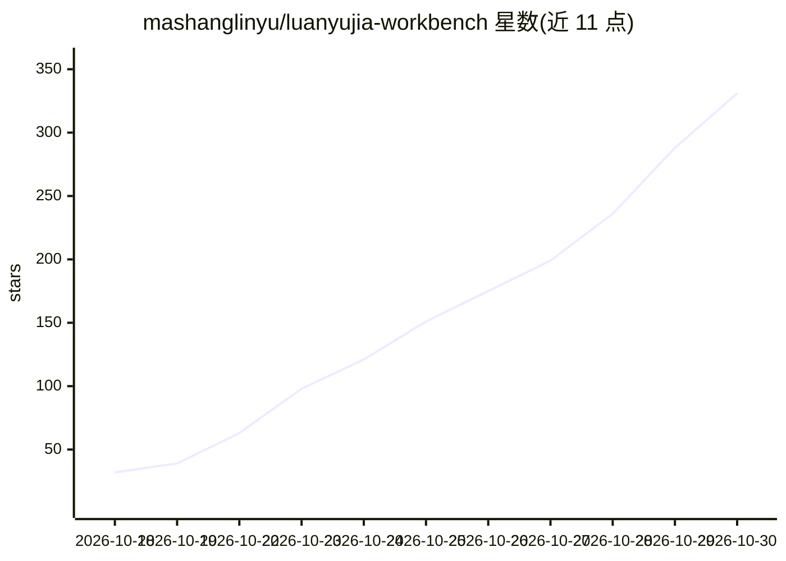

# mashanglinyu/luanyujia-workbench

⭐ 331 · JavaScript · MIT · 推送 2026-10-28 · [GitHub](https://github.com/mashanglinyu/luanyujia-workbench) · [官网](https://luanyujia.pages.dev) · 个人维护 · 中文 README

**多场景 AI 桌面工作台的搭建方法与纯壳模板（作者淋雨家）**

由个人作者「淋雨家」开源（MIT）的方法论文档仓库 + 纯壳模板：把本地 AI 助手包进分场景的桌面工作台，每个场景有独立界面（网格面板）与常驻 AI 会话，AI 具备场景身份、记忆与会话绑定。内容按 00-11 十二个板块组织，含约 7,600 行脱敏源码、10 个场景实例、MCP 接免费网页版 AI 的桥接方法、多 AI 协作规矩、37 篇 agent 产品逆向拆解笔记，以及一个双击可跑的单文件最小 demo。README 明确声明：不是装完就能用，路径均为占位符，场景配置、会话 id、MCP 桥等需按自身环境调试。

## 筛选速览

| 维度 | 判定 | 备注 |
|---|---|---|
| AI 角色 | `ai-ecosystem` | LLM/agent 周边工具 |
| 许可风险 | `permissive` | MIT |
| 部署形态 | `None` |  |
| 模型依赖 | — | README 未给出锁定关系 |
| 硬件要求 | — | 无带数字的原话,不猜 |
| 安装摩擦 | `low` | 无编译、无系统依赖或容器化 |
| 成熟度 | — | 结构信号不足 |

## 能力要点

- 会话绑定三字段实现「切场景=切脑子」的场景身份与记忆机制
- MCP 把网页版免费 AI 接成本地工具、不花 API token 的桥接方案
- 约 7,600 行脱敏源码 + 10 个真实场景配置（脱敏）+ 24 种面板类型总览
- 单文件、零依赖、双击可跑的最小演示壳

## 适用场景

- 想自己搭一间按场景分工的本地 AI 工作台，参考方法与源码
- 研究多 AI 会话协作、记忆机制与场景切换的实现思路
- 用 MCP 把网页版 AI 接成本地原生工具以节省 API 费用

## 场景标签

`AI 助手` `教程课程` · 领域:对话与助手

## 证据(README 行号)

> L42: 把本地 AI 助手包进一个**分场景的桌面工作台**：
> L62: |03|**MCP 接免费 AI**|把网页版免费 AI 接成本地原生工具，不花 API token|`03-MCP接免费AI/`|
> L69: |**10**|**源码** ★|**真正跑着的代码**：会话绑定/轮换(687行) · 免费AI桥(360) · 三个面板实现(5,300) · 启动链路|10-源码/|

## 星数曲线

2026-10-18 32 → 2026-10-30 331（+299）

---
*卡片 v1 · prompt 1.4 · 生成 2026-10-23 · 置信度 high · 依据 README sha `b32dc4a21582` · [字段定义](../../DATASET.md)*
