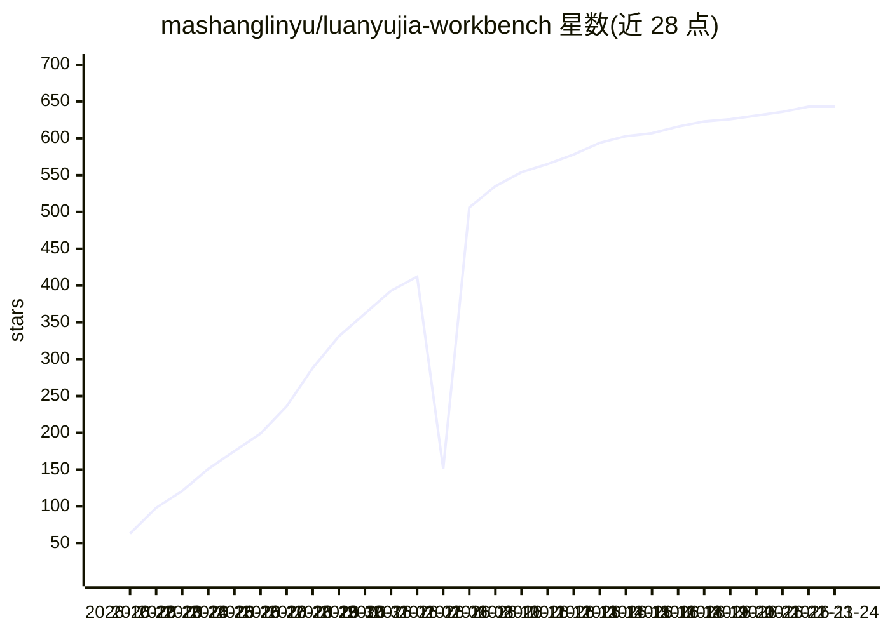

# mashanglinyu/luanyujia-workbench

⭐ 650 · JavaScript · MIT · 推送 2026-11-16 · [GitHub](https://github.com/mashanglinyu/luanyujia-workbench) · [官网](https://luanyujia.pages.dev) · 个人维护 · 中文 README

**多场景本地 AI 工作台的搭建方法、模板与外壳源码**

本仓库提供一套多场景 AI 工作台的搭建方法与纯壳模板：把本地 AI 助手装入分场景的 Electron 桌面界面，每个场景含网格面板与常驻会话，配套记忆机制、会话绑定、多 AI 协作规矩与 MCP 接网页版免费 AI 的方案。内容以 13 个板块的文档为主（含 11 个脱敏场景配置、约 6,550 行源码摘录、单文件最小 demo），并提供四场景可运行模板，需 Node.js 24.9+ 与自行安装 DSH 引擎。作者声明场景配置需按使用者自己的环境调试，路径均为占位符。

## 筛选速览

| 维度 | 判定 | 备注 |
|---|---|---|
| AI 角色 | `ai-knowledge` | 知识聚合/清单类 |
| 许可风险 | `permissive` | MIT |
| 部署形态 | `library` | 以包/库形式分发 |
| 模型依赖 | — | README 未给出锁定关系 |
| 硬件要求 | — | 无带数字的原话,不猜 |
| 安装摩擦 | `low` | 无编译、无系统依赖或容器化 |
| 成熟度 | `idea` | |

## 能力要点

- 六层拓扑结构（宿主/命令台/宪法/共享层/场景/项目）与配套记忆机制
- 11 个脱敏真实场景配置与 24 种面板类型注册说明
- 单文件零依赖最小可运行 demo，双击即可查看外观
- MCP 方案把网页版免费 AI 接成本地原生工具，不消耗 API token

## 适用场景

- 想给自己的本地 AI 助手搭一间分场景桌面工作台
- 管理多个并行 AI 会话时的身份、记忆与协作规矩
- 用 MCP 桥把网页版免费 AI 接成本地工具以节省 token

## 场景标签

`AI 助手` `Agent 记忆` `多智能体` · 领域:Agent 开发

## 证据(README 行号)

> L11: > 一套**多场景 AI 工作台**的搭建方法与纯壳模板 —— 把「一个聊天窗口」变成「一间按场景分工的工作室」。
> L92: |**12**|**源码照搬（公开版工作台 · 可直接跑）** ★|四场景（命令 / B站 / 自我复盘 / 本地电脑）+ **完整外壳源码**（顶栏入口：个人站 / DSH 集市 / 赞助小鱼干）+ 记忆机制骨架 + 记忆工具；

## 星数曲线

2026-10-22 63 → 2026-11-24 643（+580）

---
*卡片 v1 · prompt 1.4 · 生成 2026-11-24 · 置信度 mid · 依据 README sha `191a3c35f5a5` · [字段定义](../../DATASET.md)*
