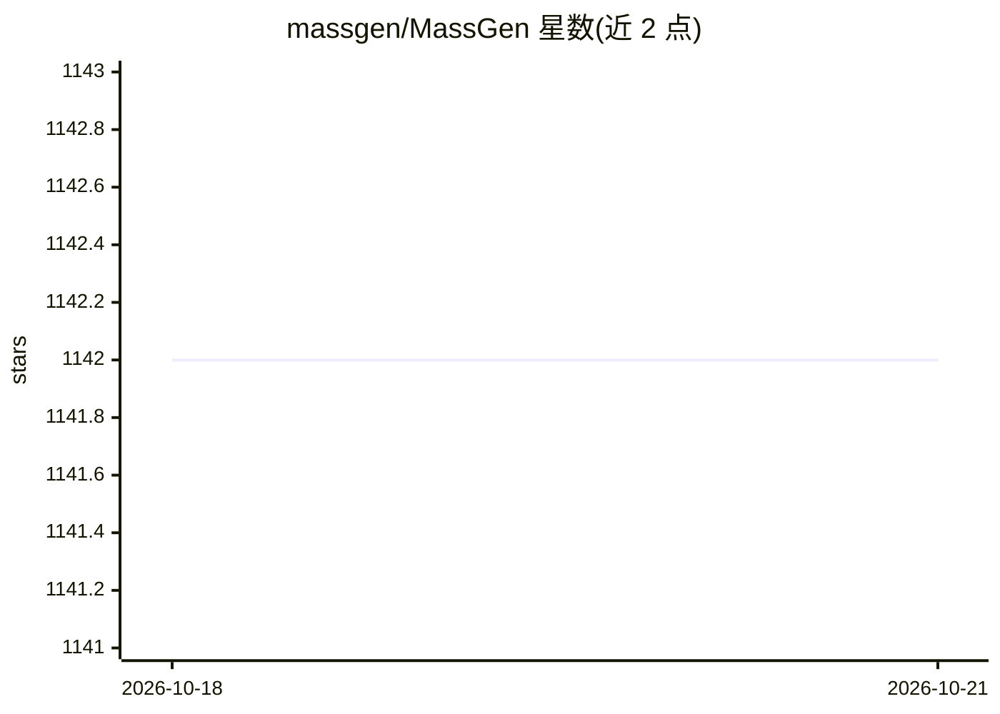

# massgen/MassGen

⭐ — · [GitHub]() · 组织维护

**终端多智能体编排系统：多模型并行解题并投票取共识**

面向开发者的开源多智能体框架：多个由不同前沿模型驱动的 agent 并行处理同一任务，通过实时共享工作摘要、迭代精炼与投票共识机制选出最终答案；默认以 Textual TUI 运行，另有 Web UI 与 Rich 显示。以 pip 包与 CLI 形式提供，`--setup` 向导配置 OpenAI/Anthropic/Google/xAI 等多家 API key、可选 Docker 代码执行环境与技能包；支持 Azure OpenAI、OpenRouter、Groq、Together、vLLM 等后端，并可作为 Agent Skills 技能被 Claude Code、Cursor 等 40+ 编码 agent 调用。Python 3.11+。

## 筛选速览

| 维度 | 判定 | 备注 |
|---|---|---|
| AI 角色 | `ai-ecosystem` | LLM/agent 周边工具 |
| 许可风险 | `none` | — |
| 部署形态 | `self-host` | docker 或自建部署 |
| 模型依赖 | local-ok | 支持本地模型 |
| 硬件要求 | — | 无带数字的原话,不猜 |
| 安装摩擦 | `low` | 无编译、无系统依赖或容器化 |
| 成熟度 | — | 结构信号不足 |

## 能力要点

- 多 agent 并行解题、共享摘要与投票共识产出最终答案
- 默认 Textual TUI：实时时间线、agent 状态卡与投票可视化
- 分层权限引擎：硬性底线规则、allow/ask/deny 声明式策略与 JSONL 审计账本
- `--setup`/`--quickstart` 向导配置 API keys、Docker 执行环境与技能包

## 适用场景

- 在终端用多个模型 agent 并行攻克研究或规划类复杂任务
- 在 Claude Code / Codex / Cursor 等编码 agent 中以技能形式调用多智能体评估
- 对比多家模型后端在同一任务上的协作产出

## 场景标签

`多智能体` `Agent 框架` · 领域:Agent 开发

## 证据(README 行号)

> L23: MassGen is a cutting-edge multi-agent framework that coordinates AI agents to solve complex tasks through redundanc
> L110:     O[🚀 MassGen Orchestrator 📋 Task Distribution & Coordination]

## 星数曲线

2026-10-18 1,142 → 2026-10-21 1,142（+0）

---
*卡片 v1 · prompt 1.4 · 生成 2026-10-21 · 置信度 mid · 依据 README sha `56ae59e149e4` · [字段定义](../../DATASET.md)*
