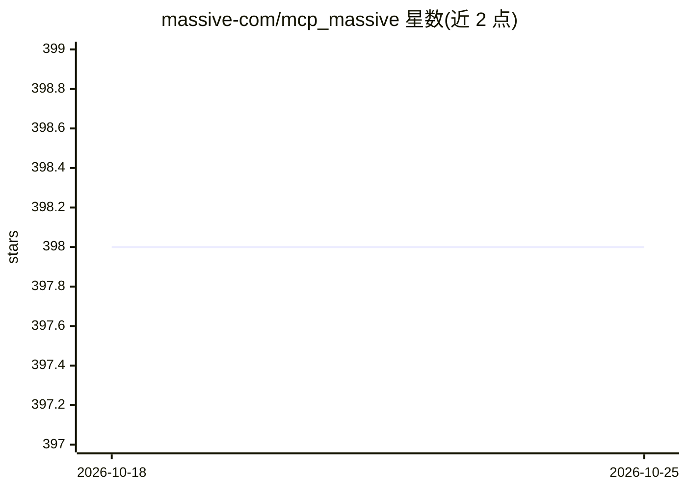

# massive-com/mcp_massive

⭐ 398 · Python · MIT · 推送 2026-10-08 · [GitHub](https://github.com/massive-com/mcp_massive) · 组织维护

**面向 LLM 的 Massive.com 金融市场数据 MCP 服务器**

由 Massive.com 维护的 Model Context Protocol 服务器，向 LLM 客户端（Claude Code、Claude Desktop 等）开放 Massive.com 金融数据 API。提供 search/call/query 三个可组合工具：检索 API 端点、调用 REST 接口、对存入内存 SQLite 的数据执行 SQL，并内置 Black-Scholes 期权定价、收益率指标与技术指标函数。启动时从 llms.txt 动态索引端点，覆盖股票、期权、外汇、加密货币、期货等数据。需 Python 3.12+、API key 与 uv，也提供官方托管实例。README 声明项目为实验性，可能有破坏性变更。

## 筛选速览

| 维度 | 判定 | 备注 |
|---|---|---|
| AI 角色 | `ai-ecosystem` | LLM/agent 周边工具 |
| 许可风险 | `permissive` | MIT |
| 部署形态 | `library` | 以包/库形式分发 |
| 模型依赖 | — | README 未给出锁定关系 |
| 硬件要求 | — | 无带数字的原话,不猜 |
| 安装摩擦 | `low` | 无编译、无系统依赖或容器化 |
| 成熟度 | `idea` | |

## 能力要点

- search/call/query 三个可组合工具覆盖整个 API 表面
- 结果存入内存 SQLite 并可用 SQL（CTE、窗口函数）查询
- 内置 Black-Scholes 定价与 Greeks、Sharpe/Sortino、SMA/EMA 等金融函数
- 支持 stdio/sse/streamable-http 三种传输，并提供官方托管服务

## 适用场景

- 在 Claude 中查询股票、期权、加密货币行情与历史数据
- 让 LLM 对 API 返回数据做 SQL 分析和金融指标计算
- 不本地安装，直接接入官方托管的 MCP 端点

## 场景标签

`金融量化` `数据分析` · 领域:效率与自动化

## 证据(README 行号)

> L14: A Model Context Protocol (MCP) server that provides access to the full Massive.com financial data API through an LL
> L16: Rather than exposing one tool per endpoint, this server gives the LLM three composable tools — **search**, **call**

## 星数曲线

2026-10-18 398 → 2026-10-25 398（+0）

---
*卡片 v1 · prompt 1.4 · 生成 2026-10-22 · 置信度 mid · 依据 README sha `9f1aaafb2182` · [字段定义](../../DATASET.md)*
