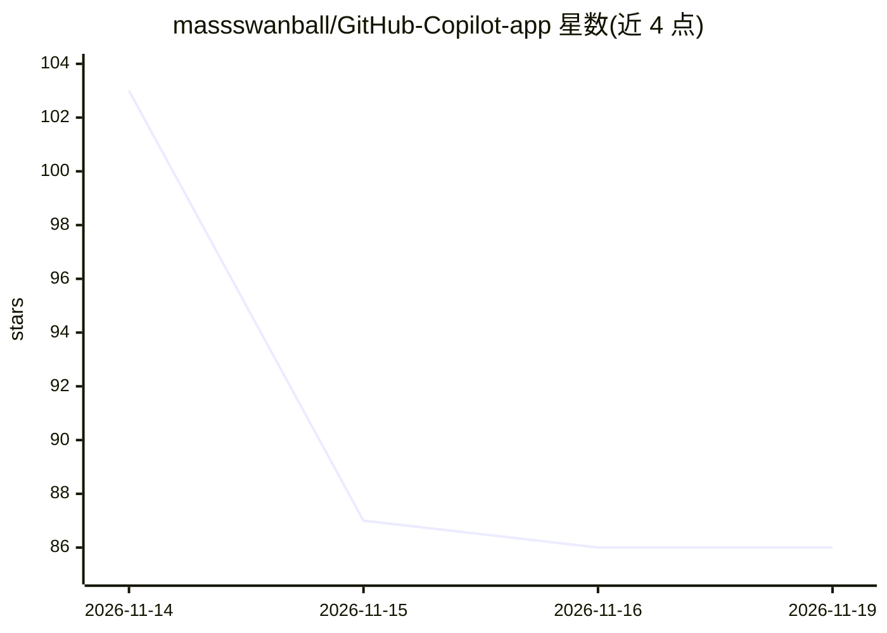

# massswanball/GitHub-Copilot-app

⭐ 86 · Apache-2.0 · 推送 2026-11-15 · [GitHub](https://github.com/massswanball/GitHub-Copilot-app) · 组织维护

**管理 GitHub 仓库软件工作的 agent 桌面客户端**

GitHub 官方发布的 agent 桌面应用：在一个界面中查找待办工作、启动与引导 Copilot agent、通过 Canvas 查看计划/终端/diff 并中途改向，以及借助 Agent Merge 推进 pull request 的评审与合并。本地会话运行在隔离 git worktree，云端会话在 GitHub 托管隔离环境中运行；另含 My Work 汇总会话/issue/PR，Automations 支持定时或后台任务。需 Git 与任意 Copilot 订阅，也支持自带密钥（BYOK）接入自有模型提供方。提供各平台安装包下载。

## 筛选速览

| 维度 | 判定 | 备注 |
|---|---|---|
| AI 角色 | `ai-ecosystem` | LLM/agent 周边工具 |
| 许可风险 | `permissive` | Apache-2.0 |
| 部署形态 | `desktop` | 安装包/桌面程序 |
| 模型依赖 | — | README 未给出锁定关系 |
| 硬件要求 | — | 无带数字的原话,不猜 |
| 安装摩擦 | `low` | 无编译、无系统依赖或容器化 |
| 成熟度 | — | 结构信号不足 |

## 能力要点

- 本地会话运行于隔离 git worktree，云端会话在 GitHub 托管环境运行
- Canvas 面板展示 agent 的计划、终端、diff 与工作流状态并支持编辑改向
- Agent Merge 承接 pull request 的评审、检查与合并条件
- BYOK 允许无 Copilot 订阅时使用自有模型提供方

## 适用场景

- 并行运行多个 Copilot agent 处理 bug 调查、issue 实现与评审反馈
- 在一个控制中心跨仓库管理会话、issue 与 pull request
- 把可重复的提示与工作流设为定时/后台任务

## 场景标签

`编码 Agent` `代码审查` · 领域:编码与开发

## 证据(README 行号)

> L3: The GitHub Copilot app is an agent-native desktop experience for finding, running, steering, and landing software wo
> L13: The GitHub Copilot app is an agent-native desktop experience for managing software work from idea to pull request. 
> L26: - A GitHub Copilot plan — any plan works, including Copilot Free and GitHub Copilot Student. No Copilot plan? You c

## 星数曲线

2026-11-14 103 → 2026-11-19 86（-17）

---
*卡片 v1 · prompt 1.4 · 生成 2026-11-17 · 置信度 high · 依据 README sha `3b7a076fe5ce` · [字段定义](../../DATASET.md)*
