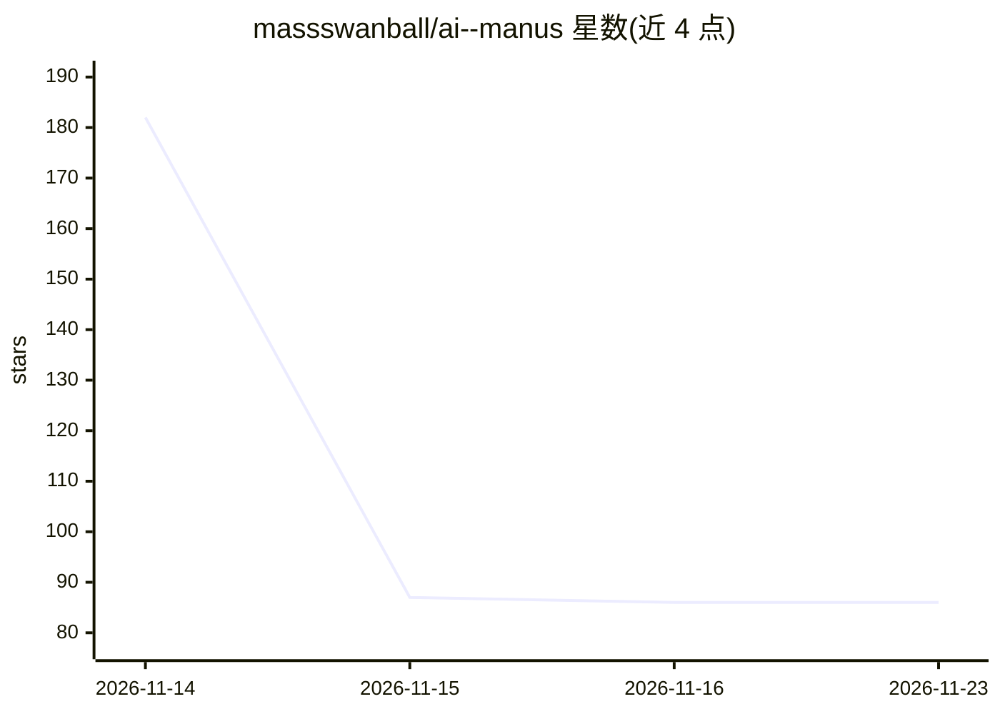

# massswanball/ai--manus

⭐ 86 · Apache-2.0 · 推送 2026-11-15 · [GitHub](https://github.com/massswanball/ai--manus) · 个人维护

**自主 AI Agent：代用户执行代码与控制浏览器完成多步任务**

面向家庭、学习与轻量办公场景的自主 AI 代理：用户以自然语言下达指令，Agent 自行编写并执行脚本、打开网页、填写表单、跨多页收集信息，并可在脚本与浏览器操作间衔接完成多步骤任务；无需用户具备开发背景。README 声明其定位为小型任务助手而非企业平台。硬件兼容表列出最低 4 GB 内存、双核 CPU；README 未给出具体的安装命令、模型接入方式或代码仓库说明，仅描述下载与配置流程。

## 筛选速览

| 维度 | 判定 | 备注 |
|---|---|---|
| AI 角色 | `ai-native` | 本体是模型或模型工具 |
| 许可风险 | `permissive` | Apache-2.0 |
| 部署形态 | `None` |  |
| 模型依赖 | — | README 未给出锁定关系 |
| 硬件要求 | — | 无带数字的原话,不猜 |
| 安装摩擦 | `low` | 无编译、无系统依赖或容器化 |
| 成熟度 | — | 结构信号不足 |

## 能力要点

- 自主执行代码：Agent 自行编写并运行脚本完成任务
- 浏览器控制：导航网页、填写表单、多页信息收集
- 脚本与浏览器操作可在同一任务流中衔接
- 面向非开发者的小规模任务自动化定位

## 适用场景

- 让学生整理研究笔记、跑小型计算脚本
- 远程工作者从多个网页收集数据并汇总
- 把重复性的小任务委托给后台代理执行

## 场景标签

`编码 Agent` `浏览器自动化` · 领域:效率与自动化

## 证据(README 行号)

> L18: Manus is an autonomous AI agent designed to run code and control a browser on your behalf. Instead of acting like a
> L22: Manus is not a heavy studio suite or a complex enterprise platform. It is a focused helper built for home, study, a

## 星数曲线

2026-11-14 182 → 2026-11-23 86（-96）

---
*卡片 v1 · prompt 1.4 · 生成 2026-11-17 · 置信度 mid · 依据 README sha `637da4fbcded` · [字段定义](../../DATASET.md)*
