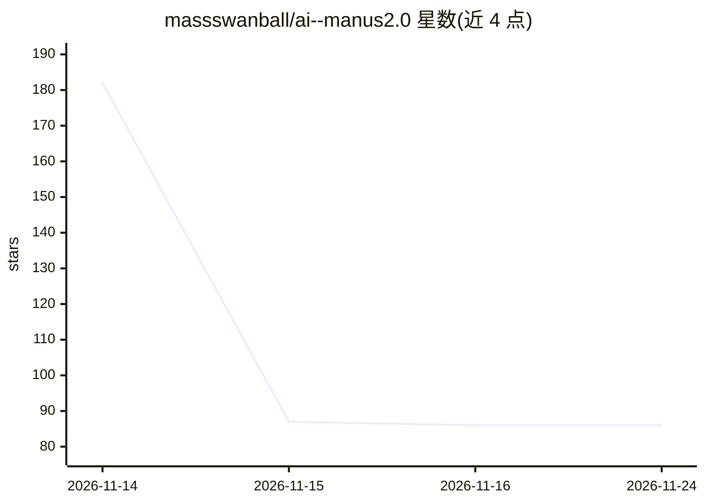

# massswanball/ai--manus2.0

⭐ 86 · Apache-2.0 · 推送 2026-11-15 · [GitHub](https://github.com/massswanball/ai--manus2.0) · 个人维护

**面向个人用户的自主 AI Agent：代跑代码并操控浏览器**

README 自述为自主 AI 代理，可代替用户编写并执行脚本、打开网页、与页面元素交互、执行多步任务，定位是家庭、学习与轻量办公场景的个人助手，面向非开发者。描述了跨会话记忆工作流模式、代码与浏览器动作可在同一任务流中衔接等能力，并给出最低/推荐硬件配置表（双核 CPU、4 GB 内存）。README 未提供任何具体的安装命令、技术架构或代码仓库内容，仅有配置与使用步骤的泛化描述，页面含下载与促销码字样。

## 筛选速览

| 维度 | 判定 | 备注 |
|---|---|---|
| AI 角色 | `ai-native` | 本体是模型或模型工具 |
| 许可风险 | `permissive` | Apache-2.0 |
| 部署形态 | `None` |  |
| 模型依赖 | — | README 未给出锁定关系 |
| 硬件要求 | — | 无带数字的原话,不猜 |
| 安装摩擦 | `low` | 无编译、无系统依赖或容器化 |
| 成熟度 | — | 结构信号不足 |

## 能力要点

- 自主执行代码与控制浏览器完成多步任务
- 面向非开发者的家庭/学习/轻办公场景定位
- 给出最低与推荐硬件兼容性表格

## 适用场景

- 让代理代为完成网页信息收集与表单填写等重复操作
- 学习中用其整理研究笔记、运行小脚本
- 远程办公时汇总多页面信息准备小型报告

## 场景标签

`AI 助手` `浏览器自动化` `编码 Agent` · 领域:效率与自动化

## 证据(README 行号)

> L10: - **Autonomous Code Execution:** Manus AI agent runs code on its own to complete tasks, so you can focus on decisio
> L18: Manus is an autonomous AI agent designed to run code and control a browser on your behalf. Instead of acting like a

## 星数曲线

2026-11-14 182 → 2026-11-24 86（-96）

---
*卡片 v1 · prompt 1.4 · 生成 2026-11-17 · 置信度 low · 依据 README sha `637da4fbcded` · [字段定义](../../DATASET.md)*
