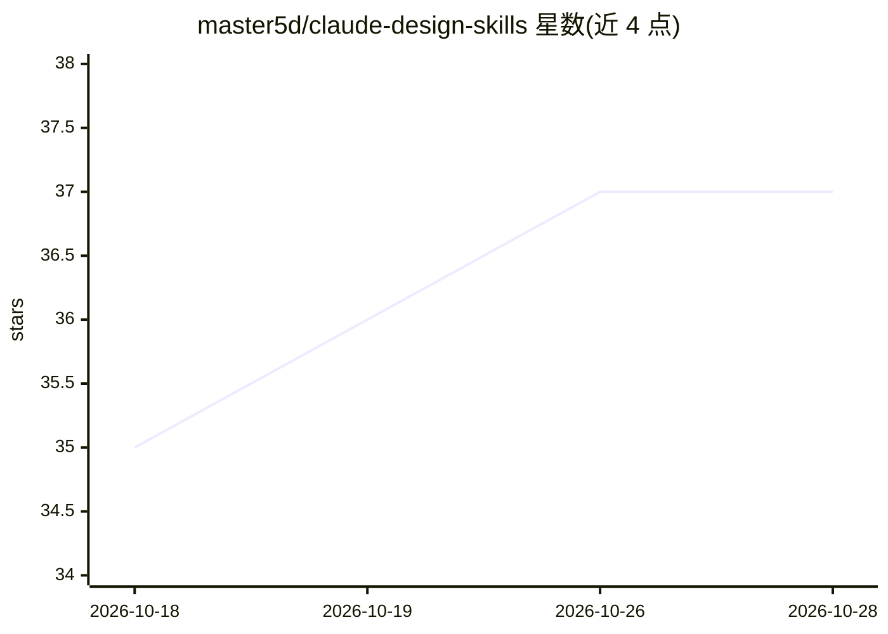

# master5d/claude-design-skills

⭐ 38 · 推送 2026-03-28 · [GitHub](https://github.com/master5d/claude-design-skills) · 个人维护

**给 Claude Code 工程师的三层 UI/UX 设计技能工具集**

面向使用 Claude Code 的工程师的插件：第一层打包 6 个设计技能文件（动效打磨、无障碍审计、SEO 元数据、动效性能、界面设计系统等），通过斜杠命令调用于编码 agent；第二层介绍 Pencil 与 Paper 两款通过 MCP 暴露设计画布的桌面工具，让 agent 直接读写设计文件并导出代码；第三层整理 Variant、Mobbin 等灵感参考站点。技能来源聚合自多个上游仓库，另推荐单独安装 Impeccable 插件。

## 筛选速览

| 维度 | 判定 | 备注 |
|---|---|---|
| AI 角色 | `ai-ecosystem` | LLM/agent 周边工具 |
| 许可风险 | `none` | — |
| 部署形态 | `None` |  |
| 模型依赖 | locked-api |  |
| 硬件要求 | — | 无带数字的原话,不猜 |
| 安装摩擦 | `low` | 无编译、无系统依赖或容器化 |
| 成熟度 | — | 结构信号不足 |

## 能力要点

- 打包 6 个设计技能：动效、无障碍、SEO、性能、界面设计等
- 整合 Pencil/Paper 两款 MCP 设计画布工具，agent 可直接读写设计文件
- 配套灵感参考工作流（Variant/Mobbin/Awwwards/Cosmos）
- 技能来源聚合 emilkowalski/skill、ibelick/ui-skills 等仓库

## 适用场景

- 写代码前用技能给 Claude Code 加载设计规范与审计能力
- 通过 MCP 让 agent 在设计画布上直接产出并导出 UI 代码
- 上线前对界面做无障碍、动效性能与元数据审计

## 场景标签

`提示工程` · 领域:Agent 开发

## 证据(README 行号)

> L7: Skills are instruction files that load design expertise into your agent. This plugin bundles 6 of them.
> L32: Design surfaces that use your agent as the kernel. No built-in AI — they expose MCP tools and let Claude do the wor

## 星数曲线

2026-10-18 35 → 2026-10-28 37（+2）

---
*卡片 v1 · prompt 1.4 · 生成 2026-10-25 · 置信度 high · 依据 README sha `8306dab27f19` · [字段定义](../../DATASET.md)*
