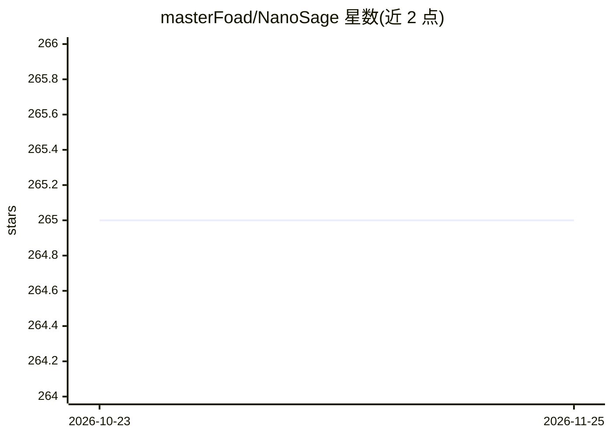

# masterFoad/NanoSage

⭐ 265 · Python · Apache-2.0 · 推送 2026-10-26 · [GitHub](https://github.com/masterFoad/NanoSage) · 个人维护

**本地 LLM 驱动的递归搜索工具：多源探索并生成报告**

在本地运行的开源深度研究工具：对用户查询做链式增强与子查询拆分，用 Monte Carlo 采样与嵌入相关性过滤探索分支，同时检索本地文件与 Web 数据（Tavily/DuckDuckGo/SearxNG/Wikipedia 等），经 RAG 用 Gemma 2B 等模型生成带引用的 Markdown 报告；混合嵌入体系用 SigLIP/CLIP 处理图像与 PDF、MiniLM 处理文本，TOC 即搜索图。面向想在笔记本上做自动调研的用户，Python 3.8+ 运行，需配置 .env 中的搜索 API key。

## 筛选速览

| 维度 | 判定 | 备注 |
|---|---|---|
| AI 角色 | `ai-native` | 本体是模型或模型工具 |
| 许可风险 | `permissive` | Apache-2.0 |
| 部署形态 | `library` | 以包/库形式分发 |
| 模型依赖 | local-ok | 支持本地模型 |
| 硬件要求 | — | 无带数字的原话,不猜 |
| 安装摩擦 | `medium` | 含编译或系统依赖之一 |
| 成熟度 | — | 结构信号不足 |

## 能力要点

- 递归子查询探索 + Monte Carlo 采样，TOC 作为搜索图追踪进度
- 混合嵌入：SigLIP/CLIP 处理视觉内容，MiniLM/ColPali 处理文本
- 报告只引用实际读取的来源，附 evidence_ledger 与运行 dashboard
- 可选的只读工具策略（read_file_lines/grep/git_explore）迭代合成

## 适用场景

- 输入一个研究问题，自动多源检索并产出结构化调研报告
- 结合本地 PDF/图片语料与 Web 数据做混合检索
- 用本地小模型（Ollama Gemma）在离线环境下完成 RAG 总结

## 场景标签

`RAG` `科研工具` · 领域:知识与检索

## 证据(README 行号)

> L5: Deep Research assistant that runs on your laptop, using tiny models. - all open source!
> L11: With Monte Carlo-based exploration, the system balances depth vs. breadth, ranking each branch's relevance to ensur
> L233: This uses **Gemma 2B** to generate LLM-based summaries and the final report.

## 星数曲线

2026-10-23 265 → 2026-11-25 265（+0）

---
*卡片 v1 · prompt 1.4 · 生成 2026-11-25 · 置信度 high · 依据 README sha `1fdd10ced9c3` · [字段定义](../../DATASET.md)*
