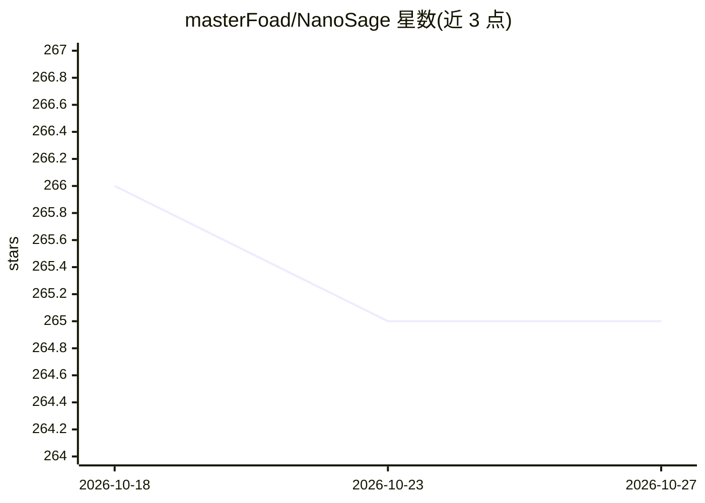

# masterFoad/NanoSage

⭐ 265 · Python · Apache-2.0 · 推送 2026-10-24 · [GitHub](https://github.com/masterFoad/NanoSage) · 个人维护

**本地小模型驱动的递归式深度研究助手，生成结构化研究报告**

运行在笔记本上的 Deep Research 工具：接收自然语言查询后，通过链式思考增强查询，用 Monte Carlo 方式在深度与广度间权衡，递归采样与相关性过滤子查询，经 Tavily API（含 DuckDuckGo/SearxNG/Wikipedia 回退）与本地文件构建知识库，以 TOC 节点树记录探索路径，最终用 Gemma 2B（经 Ollama）通过 RAG 生成多章节 Markdown 报告，并可渲染本地可视化仪表盘。混合嵌入架构区分 SigLIP/CLIP 视觉与 all-MiniLM 文本模型，支持有限的只读 agentic 工具（read_file_lines/grep/git_explore）。依赖 Python 3.8+，可 CPU 运行，GPU 加速与 CUDA 安装为可选项。

## 筛选速览

| 维度 | 判定 | 备注 |
|---|---|---|
| AI 角色 | `ai-native` | 本体是模型或模型工具 |
| 许可风险 | `permissive` | Apache-2.0 |
| 部署形态 | `library` | 以包/库形式分发 |
| 模型依赖 | local-ok | 支持本地模型 |
| 硬件要求 | — | 无带数字的原话,不猜 |
| 安装摩擦 | `medium` | 含编译或系统依赖之一 |
| 成熟度 | — | 结构信号不足 |

## 能力要点

- Monte Carlo 子查询采样与相关性过滤，平衡搜索深度与广度
- TOC 节点树记录递归搜索路径，最终 RAG 生成多章节 Markdown 报告
- 混合嵌入架构：SigLIP/CLIP 处理视觉内容，all-MiniLM 处理文本
- 本地工具策略（read_file_lines/grep/git_explore）与运行可视化仪表盘

## 适用场景

- 对开放性问题自动多源检索并产出结构化研究报告
- 结合本地 PDF/文本/图片与网络资料做综合调研
- 在无云端 LLM 的环境下用 Gemma 2B 通过 Ollama 完成研究总结

## 场景标签

`科研工具` `RAG` · 领域:知识与检索

## 证据(README 行号)

> L3: Deep Research assistant that runs on your laptop, using tiny models. - all open source!
> L9: With Monte Carlo-based exploration, the system balances depth vs. breadth, ranking each branch's relevance to ensure
> L220: This uses **Gemma 2B** to generate LLM-based summaries and the final report.

## 星数曲线

2026-10-18 266 → 2026-10-27 265（-1）

---
*卡片 v1 · prompt 1.4 · 生成 2026-10-22 · 置信度 high · 依据 README sha `19dee40d6d38` · [字段定义](../../DATASET.md)*
