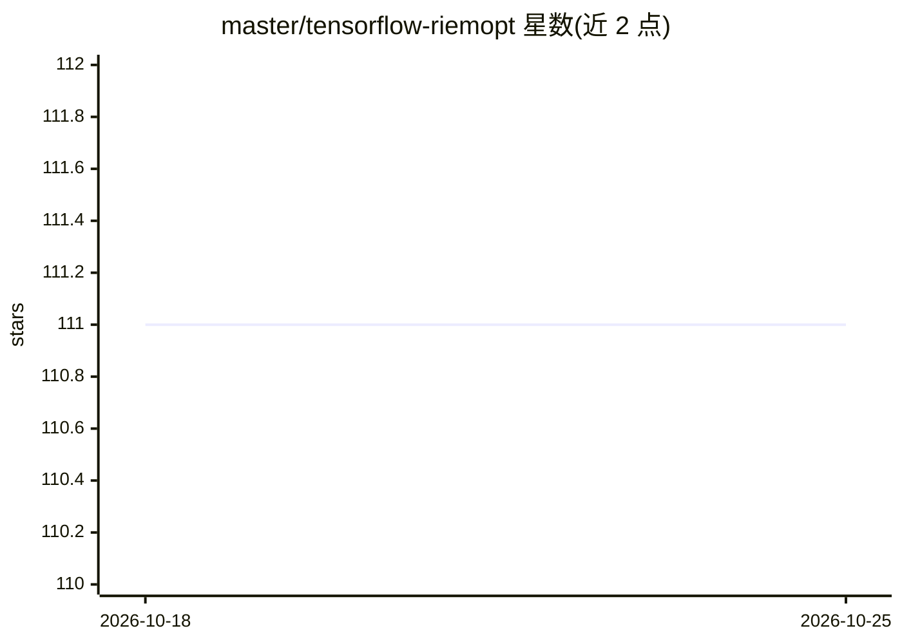

# master/tensorflow-riemopt

⭐ 111 · Python · MIT · 推送 2025-12-27 · [GitHub](https://github.com/master/tensorflow-riemopt) · [官网](https://tensorflow-riemopt.readthedocs.io/en/latest/) · 个人维护

**面向 TensorFlow 的黎曼流形约束优化库**

基于 TensorFlow 实现黎曼流形上的约束优化：提供 14 种流形（Sphere、Stiefel、SPD 系列、双曲空间等）及指数/对数映射、测地线、收缩与传输等微分几何概念，无闭式解时提供数值近似；包含 RiemannianSGD/RiemannianAdam 等优化器，可作为 Keras 优化器的直接替换，支持 Eager 与 Graph 模式下的稀疏/稠密更新，另有流形约束 Embedding 层。附 ANTHEM、SPDNet 等论文复现示例，附 arXiv 论文与 MIT 许可。

## 筛选速览

| 维度 | 判定 | 备注 |
|---|---|---|
| AI 角色 | `ai-native` | 本体是模型或模型工具 |
| 许可风险 | `permissive` | MIT |
| 部署形态 | `library` | 以包/库形式分发 |
| 模型依赖 | — | README 未给出锁定关系 |
| 硬件要求 | — | 无带数字的原话,不猜 |
| 安装摩擦 | `low` | 无编译、无系统依赖或容器化 |
| 成熟度 | — | 结构信号不足 |

## 能力要点

- 14 种流形实现（Sphere/Stiefel/SPD 系列/Poincaré/Hyperboloid 等）
- RiemannianSGD/RiemannianAdam/ConstrainedRMSProp 可直接替换 Keras 优化器
- 支持 Eager 与 Graph 模式下的稀疏与稠密更新
- 附 ANTHEM、SPDNet、双曲神经网络等论文示例

## 适用场景

- 在双曲或 SPD 等非欧空间中训练神经网络
- 为嵌入层施加单位范数或正交性约束
- 复现流形上的深度学习论文方法

## 场景标签

`模型训练` · 领域:训练与推理

## 证据(README 行号)

> L11: A library for manifold-constrained optimization in TensorFlow.
> L60:  Constrained optimization algorithms work as drop-in replacements for Keras
> L73:  - ANTHEM - Choudhary, Nurendra, Nikhil Rao, Sumeet Katariya, Karthik Subbian, and Chandan K. Reddy. "ANTHEM: Atten

## 星数曲线

2026-10-18 111 → 2026-10-25 111（+0）

---
*卡片 v1 · prompt 1.4 · 生成 2026-10-23 · 置信度 high · 依据 README sha `e577cb1c3464` · [字段定义](../../DATASET.md)*
