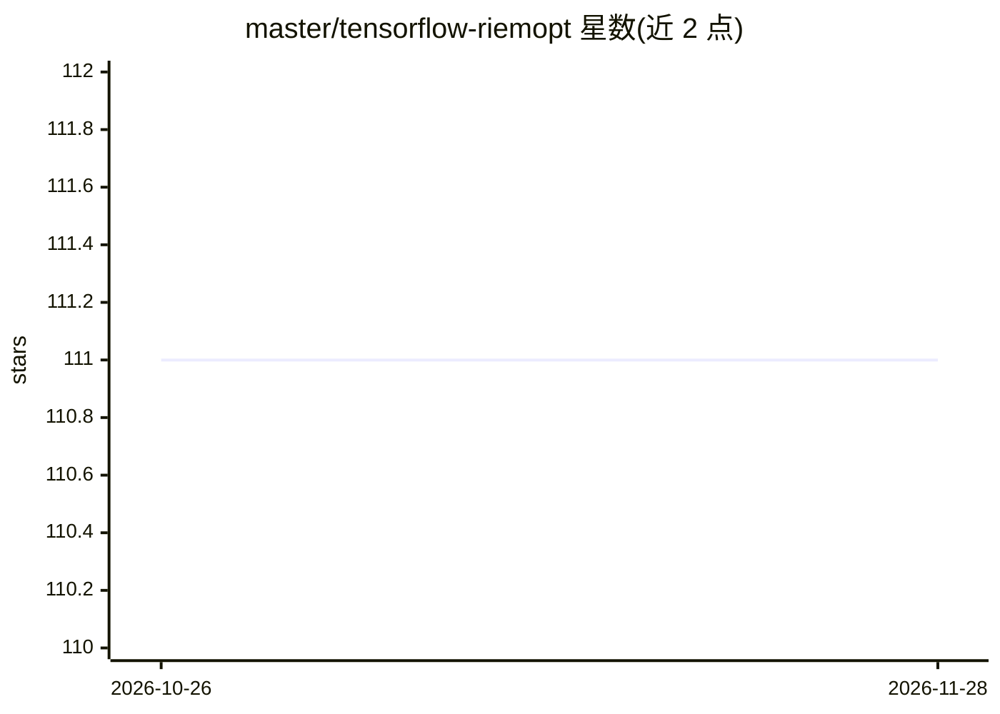

# master/tensorflow-riemopt

⭐ 111 · Python · MIT · 推送 2026-11-23 · [GitHub](https://github.com/master/tensorflow-riemopt) · [官网](https://tensorflow-riemopt.readthedocs.io/en/latest/) · 个人维护

**TensorFlow 黎曼流形约束优化库，供 ML 研究者使用**

基于 TensorFlow 的流形约束优化库，实现微分几何概念：多种流形（双曲、SPD 矩阵、Stiefel、Grassmannian 等）及配套的黎曼度量、指数/对数映射、测地线、收缩与传输；闭式解不可用时提供数值近似。优化器（RiemannianSGD/RiemannianAdam/ConstrainedRMSprop）可作为 Keras 优化器的直接替换，支持稀疏与稠密更新及 Eager/Graph 模式，另提供流形约束的 Embedding 层。通过 PyPI 或 GitHub 源码安装，附 ANTHEM、SPDNet 等论文复现示例。

## 筛选速览

| 维度 | 判定 | 备注 |
|---|---|---|
| AI 角色 | `ai-native` | 本体是模型或模型工具 |
| 许可风险 | `permissive` | MIT |
| 部署形态 | `library` | 以包/库形式分发 |
| 模型依赖 | — | README 未给出锁定关系 |
| 硬件要求 | — | 无带数字的原话,不猜 |
| 安装摩擦 | `low` | 无编译、无系统依赖或容器化 |
| 成熟度 | — | 结构信号不足 |

## 能力要点

- 13 种流形实现，含双曲空间、SPD 矩阵、Stiefel、Grassmannian
- RiemannianSGD/RiemannianAdam 等 Keras 优化器直接替换
- 支持稀疏与稠密更新的 Eager/Graph 双模式
- 提供数值近似处理无闭式解的流形

## 适用场景

- 在双曲或 SPD 流形上训练神经网络（如 SPDNet、LieNet）
- 为 Keras 模型替换标准优化器为黎曼优化器
- 复现流形深度学习相关论文实验

## 场景标签

 · 领域:机器学习/优化算法库

## 证据(README 行号)

> L12: A library for manifold-constrained optimization in TensorFlow.
> L44: The core package implements concepts in differential geometry, such as
> L78:  - `optimizers.RiemannianSGD` - Riemannian Gradient Descent

## 星数曲线

2026-10-26 111 → 2026-11-28 111（+0）

---
*卡片 v1 · prompt 1.4 · 生成 2026-11-28 · 置信度 high · 依据 README sha `668693465f9c` · [字段定义](../../DATASET.md)*
