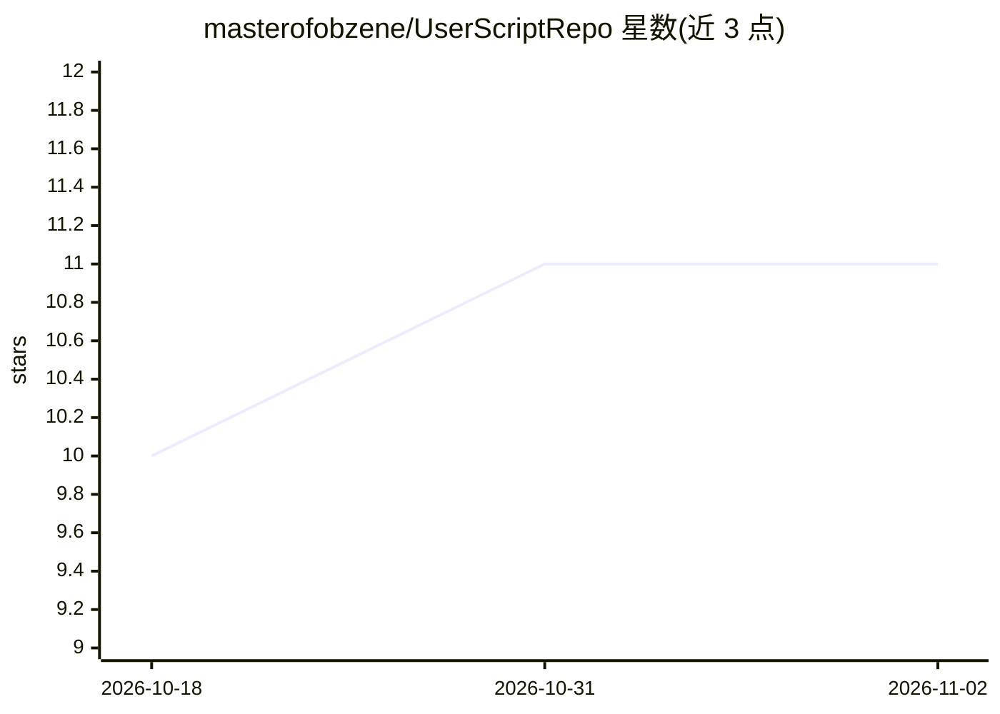

# masterofobzene/UserScriptRepo

⭐ 11 · JavaScript · GPL-3.0 · 推送 2026-10-31 · [GitHub](https://github.com/masterofobzene/UserScriptRepo) · 个人维护

**个人油猴脚合集：为 GOG/Steam/DDG/DeepSeek 等站点加过滤与便利功能**

个人维护的 userscript 集合，分为 SFW 与 NSFW 两部分，另含少量浏览器扩展。SFW 脚本覆盖 GOG/Steam 商店过滤与隐藏、价格筛选、YouTube 跳过、DuckDuckGo 搜索过滤器，以及对 DeepSeek、Grok、Stable Diffusion Forge 界面的体验改进；NSFW 部分为图片站下载器、画廊过滤与标签隐藏工具。脚本面向 Firefox/LibreWolf 编写，需 Violentmonkey/Tampermonkey 等脚本管理器安装，Chrome/Brave 未经保证。

## 筛选速览

| 维度 | 判定 | 备注 |
|---|---|---|
| AI 角色 | `ai-enhanced` | 去掉 AI 部分产品仍成立 |
| 许可风险 | `viral` | GPL-3.0 |
| 部署形态 | `None` |  |
| 模型依赖 | — | README 未给出锁定关系 |
| 硬件要求 | — | 无带数字的原话,不猜 |
| 安装摩擦 | `low` | 无编译、无系统依赖或容器化 |
| 成熟度 | — | 结构信号不足 |

## 能力要点

- GOG/Steam 商店游戏隐藏、最低价过滤与促销过滤
- DeepSeek 与 Grok 界面体验改进（QoL）脚本
- Stable Diffusion Forge UI 便利性改进
- 多个图片站下载器与画廊过滤/隐藏脚本

## 适用场景

- 在 Steam/GOG 商店隐藏低质或低于设定价格的游戏
- 改进 DeepSeek/Grok 等 AI 站点的界面操作
- 批量下载或过滤图片站内容

## 场景标签

`网页抓取` · 领域:效率与自动化

## 证据(README 行号)

> L93: DeepSeek QoL Merged the DeepSeek scripts into one. Also added new features.
> L99: Grok QoL Makes the copy code button appear below the answers instead of at the top and makes scrollbars visible aga

## 星数曲线

2026-10-18 10 → 2026-11-02 11（+1）

---
*卡片 v1 · prompt 1.4 · 生成 2026-11-02 · 置信度 high · 依据 README sha `e7e0ddea018d` · [字段定义](../../DATASET.md)*
