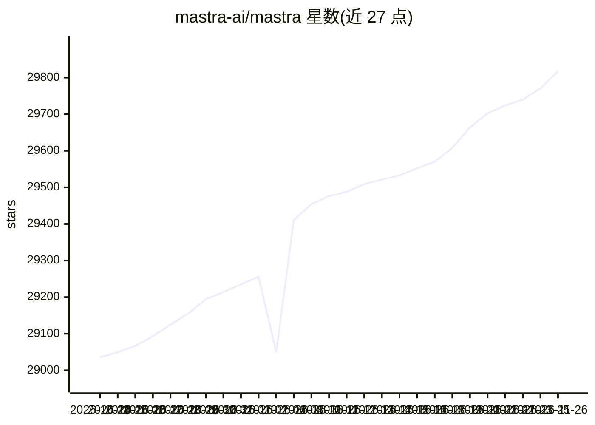

# mastra-ai/mastra

⭐ 29,817 · TypeScript · NOASSERTION · 推送 2026-11-25 · [GitHub](https://github.com/mastra-ai/mastra) · [官网](https://mastra.ai) · 组织维护

**给 TypeScript 开发者的 AI 应用与 Agent 构建框架**

面向 TypeScript 技术栈的框架，用于构建 AI 应用与自主 Agent：提供模型路由（统一接口接入 40+ 供应商）、基于图的 workflow 引擎（.then/.branch/.parallel 控制流）、基于存储的挂起/恢复式 human-in-the-loop、上下文与记忆管理、MCP server 编写、内置 evals 与可观测性。可嵌入 React/Next.js/Node.js 应用或作为独立服务部署。核心代码 Apache-2.0 开源，ee/ 目录下的功能需企业许可方可生产使用。

## 筛选速览

| 维度 | 判定 | 备注 |
|---|---|---|
| AI 角色 | `ai-ecosystem` | LLM/agent 周边工具 |
| 许可风险 | `none` | NOASSERTION |
| 部署形态 | `None` |  |
| 模型依赖 | — | README 未给出锁定关系 |
| 硬件要求 | — | 无带数字的原话,不猜 |
| 安装摩擦 | `low` | 无编译、无系统依赖或容器化 |
| 成熟度 | — | 结构信号不足 |

## 动量与使用信号

- 维护:`active` — 距上次 push 0.6 天,年发版 97,467 位贡献者
- 涨星:近 1 天 **+22**(自 20261016 起算)
- 安装:npm 包 `bgproc` 月下载 13,832
- 平台:— · 协议:MCP

## 能力要点

- 模型路由：一个标准接口连接 40+ 模型供应商
- 图式 workflow 引擎与基于存储的无限期挂起/恢复
- 可编写 MCP server，暴露 agents 与 tools
- 内置 evals 与可观测性工具

## 适用场景

- 用 TypeScript 构建 LLM Agent 应用
- 需要多步编排和人工审批环节的 AI 流程
- 对 Agent 做评估、观测与迭代优化
- 以 MCP 协议对外暴露工具与资源

## 场景标签

`Agent 框架` `模型网关` `LLM 可观测性` `模型评测` · 领域:Agent 开发

## 证据(README 行号)

> L11: Mastra is a framework for building AI-powered applications and agents with a modern TypeScript stack.
> L21: - **Model routing**: Connect to 40+ providers through one standard interface. Use models from OpenAI, Anthropic, Ge

## 星数曲线

2026-10-24 29,036 → 2026-11-26 29,817（+781）

---
*卡片 v1 · prompt 1.4 · 生成 2026-11-22 · 置信度 high · 依据 README sha `86b77a608213` · [字段定义](../../DATASET.md)*
