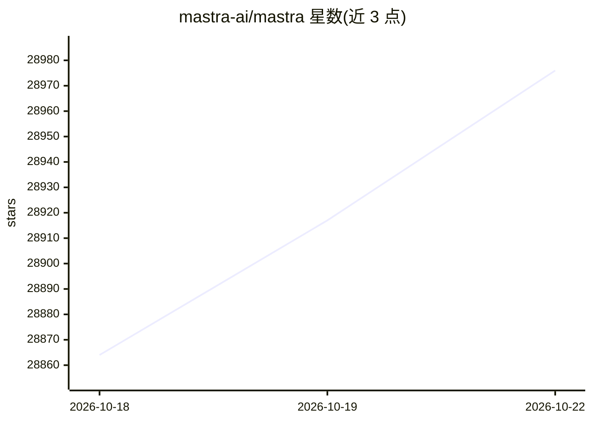

# mastra-ai/mastra

⭐ 29,011 · TypeScript · NOASSERTION · 推送 2026-10-22 · [GitHub](https://github.com/mastra-ai/mastra) · [官网](https://mastra.ai) · 组织维护

**面向开发者的 TypeScript AI 应用与 Agent 框架**

Mastra 提供基于 TypeScript 的框架，用于构建 AI 应用与 Agent，覆盖从原型到生产部署的环节。关键机制包括：统一接口接入 40+ 模型提供商的模型路由、基于图的 workflow 引擎（.then/.branch/.parallel）、human-in-the-loop 暂停恢复（依赖存储保存执行状态）、上下文与记忆管理、MCP server 编写，以及内置 evals 与可观测性。可嵌入 React/Next.js/Node.js 应用或作为独立服务部署。仓库采用 Apache-2.0 与企业许可的双许可模式，`ee/` 目录代码生产使用需企业许可。

## 筛选速览

| 维度 | 判定 | 备注 |
|---|---|---|
| AI 角色 | `ai-native` | 本体是模型或模型工具 |
| 许可风险 | `dual` | NOASSERTION |
| 部署形态 | `None` |  |
| 模型依赖 | — | README 未给出锁定关系 |
| 硬件要求 | — | 无带数字的原话,不猜 |
| 安装摩擦 | `low` | 无编译、无系统依赖或容器化 |
| 成熟度 | — | 结构信号不足 |

## 动量与使用信号

- 维护:`active` — 距上次 push 0.6 天,年发版 97,467 位贡献者
- 涨星:近 1 天 **+22**(自 20261016 起算)
- 安装:npm 包 `bgproc` 月下载 13,832
- 平台:— · 协议:MCP

## 能力要点

- 模型路由：单一标准接口接入 40+ 提供商（OpenAI、Anthropic、Gemini 等）
- 图式 workflow 引擎与 human-in-the-loop 暂停/恢复机制
- MCP server 编写：以标准协议暴露 agents、tools 与资源
- 内置 evals 与可观测性支持生产迭代

## 适用场景

- 用 TypeScript 从零搭建 AI Agent 应用并接入多家模型
- 把 Agent 与 workflow 打包进现有 React/Next.js/Node.js 项目
- 需要人工审批环节的多步骤自动化流程
- 为 Agent 添加评测与可观测性以持续调优

## 场景标签

`Agent 框架` `模型网关` `LLM 可观测性` `模型评测` · 领域:Agent 开发

## 证据(README 行号)

> L11: Mastra is a framework for building AI-powered applications and agents with a modern TypeScript stack.
> L21: - **Model routing**: Connect to 40+ providers through one standard interface. Use models from OpenAI, Anthropic, Ge
> L33: - **MCP servers**: Author Model Context Protocol servers, exposing agents, tools, and other structured resources vi

## 星数曲线

2026-10-18 28,864 → 2026-10-22 28,976（+112）

---
*卡片 v1 · prompt 1.4 · 生成 2026-10-18 · 置信度 high · 依据 README sha `7dddec294672` · [字段定义](../../DATASET.md)*
