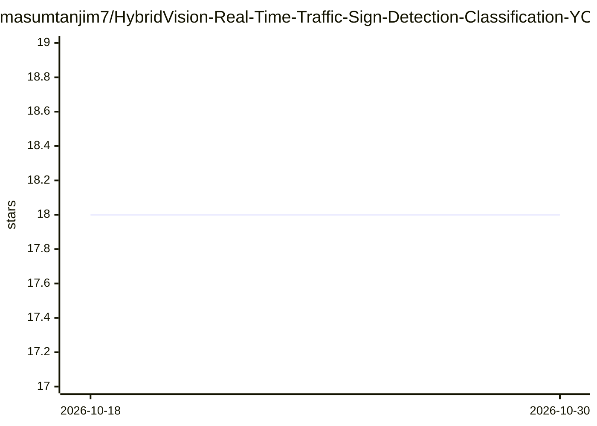

# masumtanjim7/HybridVision-Real-Time-Traffic-Sign-Detection-Classification-YOLOv8-ResNet50

⭐ 18 · Jupyter Notebook · GPL-3.0 · 推送 2026-09-25 · [GitHub](https://github.com/masumtanjim7/HybridVision-Real-Time-Traffic-Sign-Detection-Classification-YOLOv8-ResNet50) · 个人维护

**面向孟加拉国路况的交通标志检测与分类系统（YOLOv7+ResNet50）**

实时交通标志识别系统，采用混合深度学习流水线：YOLOv7 检测器定位标志框，ResNet50 对裁剪区域做细粒度分类，通过基于置信度的融合策略输出最终预测。作者自建孟加拉国交通标志数据集（9,133 张图像、29 类，经 Roboflow 标注），在 Kaggle P100 GPU 上训练，产出 YOLO/ResNet 权重与标签映射，并以 Streamlit Web 应用部署，支持图片、视频与摄像头三种输入。README 未给出安装运行命令，测试了 YOLOv5/7/8/11 多版本检测器后选定 YOLOv7+ResNet50。

## 筛选速览

| 维度 | 判定 | 备注 |
|---|---|---|
| AI 角色 | `ai-native` | 本体是模型或模型工具 |
| 许可风险 | `viral` | GPL-3.0 |
| 部署形态 | `None` |  |
| 模型依赖 | — | README 未给出锁定关系 |
| 硬件要求 | — | 无带数字的原话,不猜 |
| 安装摩擦 | `low` | 无编译、无系统依赖或容器化 |
| 成熟度 | — | 结构信号不足 |

## 能力要点

- YOLOv7 检测 + ResNet50 分类 + 置信度融合的混合流水线
- 自建孟加拉国交通标志数据集（9,133 张、29 类，Roboflow 标注）
- Streamlit Web 应用支持图片/视频/摄像头实时识别
- 提供 YOLO 权重、ResNet 权重与标签映射等部署产物

## 适用场景

- 识别孟加拉国道路环境中的交通标志并细分类别
- 通过图片、视频或摄像头实时检测交通标志
- 作为自动驾驶感知模块的原型进行扩展开发

## 场景标签

`目标检测` · 领域:感知与多模态

## 证据(README 行号)

> L3: HybridVision is a **real-time traffic sign recognition system** built with a **hybrid deep learning pipeline** for b
> L4: It combines a YOLO detector to localize signs (bounding boxes) and a ResNet50 classifier to identify the exact traff

## 星数曲线

2026-10-18 18 → 2026-10-30 18（+0）

---
*卡片 v1 · prompt 1.4 · 生成 2026-10-29 · 置信度 high · 依据 README sha `2b55c815f4e3` · [字段定义](../../DATASET.md)*
