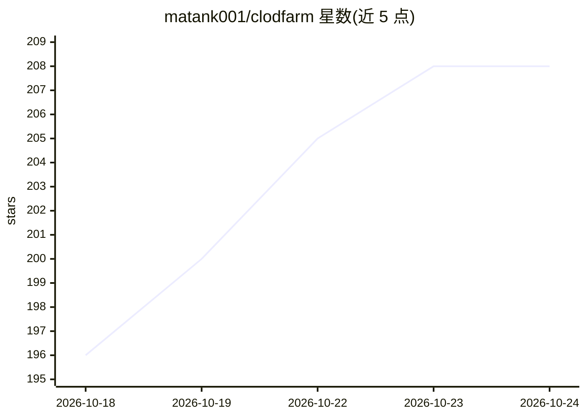

# matank001/clodfarm

⭐ 209 · Python · MIT · 推送 2026-10-23 · [GitHub](https://github.com/matank001/clodfarm) · [官网](https://towers.app) · 个人维护

**多账号 Claude Code agent 集群编排系统：全天运行、按量限速**

在 Docker 容器中运行一组 Claude Code agent 的编排层：通过手机 Claude 应用下达任务，任务拆分为子 agent，在各账号真实 5 小时/每周用量额度内调度；支持多账号协作、定时任务、测试通过才合入主分支、白板、看板。通过 bot 机制接入 OpenAI、xAI、Gemini、Groq、OpenRouter、Ollama 等其他模型承担任务。集成 Stripe 收款、Google Ads、AWS 部署、X 社媒等连接器。一行脚本安装，状态存于 SQLite，无外部数据库。

## 筛选速览

| 维度 | 判定 | 备注 |
|---|---|---|
| AI 角色 | `ai-ecosystem` | LLM/agent 周边工具 |
| 许可风险 | `permissive` | MIT |
| 部署形态 | `self-host` | docker 或自建部署 |
| 模型依赖 | local-ok | 支持本地模型 |
| 硬件要求 | — | 无带数字的原话,不猜 |
| 安装摩擦 | `low` | 无编译、无系统依赖或容器化 |
| 成熟度 | — | 结构信号不足 |

## 能力要点

- 按每个 Claude 账号真实 5 小时/每周用量限速调度，预留 20% 且不超额付费
- 任务拆分为可见子 agent，测试通过才合入 main，崩溃重启不丢工作
- bot 机制让 Claude Code 运行在 OpenAI/Grok/Gemini/Groq/OpenRouter/Ollama 模型上
- Stripe/Google Ads/AWS/X/Slack/Blender 等连接器与定时任务、看板

## 适用场景

- 让 Claude 订阅账号全天候构建、部署和运营应用
- 团队多账号协作分担 agent 工作负载
- 从手机 Claude 应用远程指挥 agent 干活

## 场景标签

`多智能体` `编码 Agent` `模型网关` · 领域:Agent 开发

## 证据(README 行号)

> L52: **clodfarm** (say it out loud) is a farm of Claude Code agents running around the clock in a container. A clod
> L68: Your Claudes run on your Claude subscription. Next to them, **bots** run Claude Code on any other lab's model, with
> L135: curl -fsSL https://raw.githubusercontent.com/matank001/clodfarm/main/scripts/install.sh | sh

## 星数曲线

2026-10-18 196 → 2026-10-24 208（+12）

---
*卡片 v1 · prompt 1.4 · 生成 2026-10-22 · 置信度 mid · 依据 README sha `15b27e17842a` · [字段定义](../../DATASET.md)*
