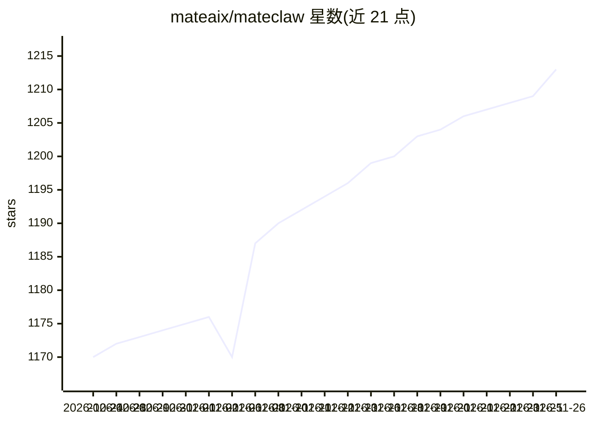

# mateaix/mateclaw

⭐ 1,213 · Java · Apache-2.0 · 推送 2026-11-25 · [GitHub](https://github.com/mateaix/mateclaw) · [官网](https://claw.mate.vip) · 组织维护 · 中文 README

**可自托管的多 Agent 数字员工平台：知识、记忆、工具、渠道一体部署**

基于 Java 21 / Spring Boot / Spring AI Alibaba（AgentScope Java）构建的自托管 Agent 平台，将推理、知识（LLM Wiki）、记忆、工具、消息渠道集成在单个 JAR 部署中。支持原生 AgentScope 运行时（ReAct、Plan-and-Execute、Goal、Team Runs）或外部 DSH 运行时；提供 Web 控制台、Electron 桌面端、网页挂件、IM 渠道与插件 SDK 五种入口。内置多用户工作区、审批门控、审计日志与 Tool Guard（RBAC + 审批 + 路径保护）；持久化 Goal 在后端重启后从检查点续跑。源码构建需 Java 21。

## 筛选速览

| 维度 | 判定 | 备注 |
|---|---|---|
| AI 角色 | `ai-ecosystem` | LLM/agent 周边工具 |
| 许可风险 | `permissive` | Apache-2.0 |
| 部署形态 | `self-host` | docker 或自建部署 |
| 模型依赖 | local-ok | 支持本地模型 |
| 硬件要求 | — | 无带数字的原话,不猜 |
| 安装摩擦 | `low` | 无编译、无系统依赖或容器化 |
| 成熟度 | — | 结构信号不足 |

## 能力要点

- 多模型故障转移：按优先级链路重试 OpenAI 兼容 provider（DashScope、OpenAI、Anthropic、Gemini、DeepSeek、Ollama 等）
- LLM Wiki 将文档消化为带 [[links]] 与可溯源引用的结构化页面
- 持久化 Goal：检查点、重启恢复、Team Run 任务 DAG 与人工审批门
- SKILL.md / MCP（stdio/SSE/HTTP）/ ACP 三种能力扩展方式

## 适用场景

- 企业内部部署可控数据与密钥的数字员工平台
- 将钉钉、飞书、企微、Telegram 等接入统一 Agent 服务
- 上传 PDF/Markdown 构建带引用的团队知识库
- 需要审批与审计的敏感操作自动化工作流

## 场景标签

`多智能体` `工作流自动化` `RAG` · 领域:Agent 开发

## 证据(README 行号)

> L31: > Multi-user workspaces. Approval-gated sensitive actions. Full audit trail. Spring Boot Actuator health monitoring
> L33: > **And underneath, a real Agent Runtime.** An employee is no longer welded to one reasoning loop. Choose the nativ
> L89: ### Agent Runtime: native or DSH (2.2.0+)

## 星数曲线

2026-10-24 1,170 → 2026-11-26 1,213（+43）

---
*卡片 v1 · prompt 1.4 · 生成 2026-11-25 · 置信度 high · 依据 README sha `1e8b3ad596f2` · [字段定义](../../DATASET.md)*
