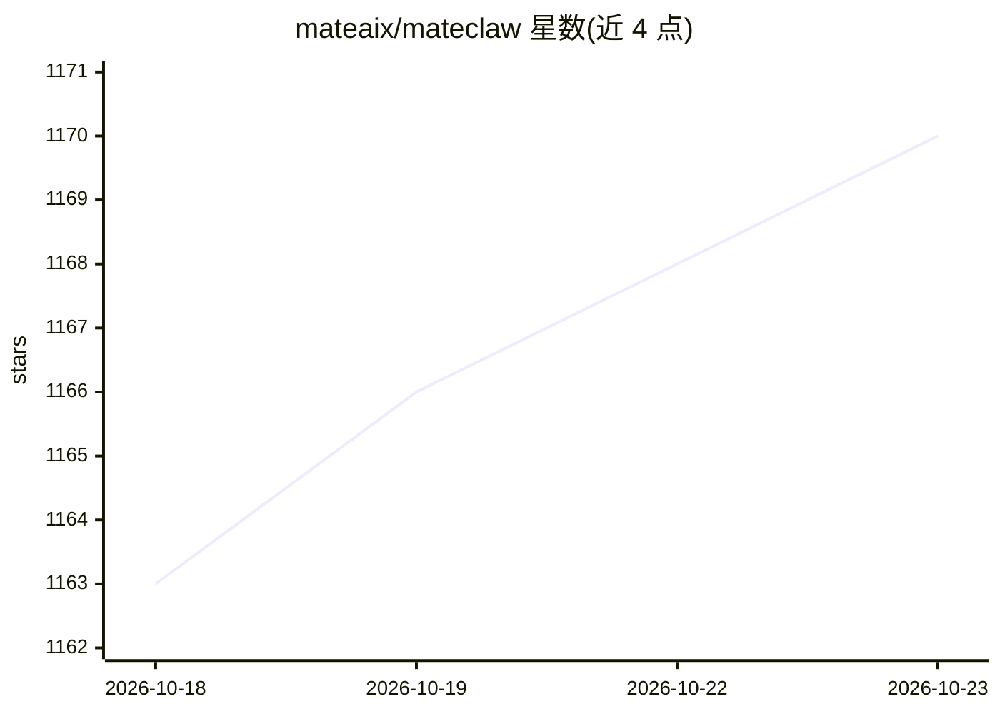

# mateaix/mateclaw

⭐ 1,170 · Java · Apache-2.0 · 推送 2026-10-22 · [GitHub](https://github.com/mateaix/mateclaw) · [官网](https://claw.mate.vip) · 组织维护 · 中文 README

**面向企业的自托管多 Agent 平台：数字员工、知识库与多渠道接入**

基于 Spring Boot / AgentScope Java 的可插拔 Agent 运行时与多用户工作台：以“数字员工”承载 ReAct、Plan-and-Execute、持久化 Goals 与 Team Runs，支持原生与 DeepSeek Harness（SDK JSON-RPC 外部循环）两种执行引擎。模型层支持多供应商按序故障转移（DashScope/OpenAI/Anthropic/DeepSeek/Kimi/Ollama 等），知识经 LLM Wiki 消化为带引用的链接页面。提供 Web 控制台、Electron 桌面端、嵌入式网页聊天、8 种 IM 渠道与 Java 插件 SDK；含 Tool Guard 审批、RBAC 与审计。当前开发版本 3.0.0-SNAPSHOT，源码构建需 Java 21。

## 筛选速览

| 维度 | 判定 | 备注 |
|---|---|---|
| AI 角色 | `ai-native` | 本体是模型或模型工具 |
| 许可风险 | `permissive` | Apache-2.0 |
| 部署形态 | `self-host` | docker 或自建部署 |
| 模型依赖 | local-ok | 支持本地模型 |
| 硬件要求 | — | 无带数字的原话,不猜 |
| 安装摩擦 | `low` | 无编译、无系统依赖或容器化 |
| 成熟度 | `idea` | |

## 能力要点

- 数字员工 + 原生/DSH 双 Agent 运行时，支持 Team Runs 与持久化 Goals 断点续跑
- 模型供应商按优先级健康故障转移，坏供应商进入冷却窗口
- LLM Wiki 将上传资料消化为带引用溯源的链接页面
- 五种交付面：Web 控制台、Electron 桌面（内置 JRE 21）、网页聊天组件、8 种 IM 渠道、Java 插件 SDK

## 适用场景

- 在自有服务器部署多用户的 AI 员工并接入钉钉/飞书等 IM
- 让数字员工执行可断点恢复的长时间任务
- 将企业资料转化为带引用的可验证知识库

## 场景标签

`多智能体` `知识库管理` `Agent 框架` · 领域:Agent 开发

## 证据(README 行号)

> L9:  Your second brain
> L33: > **And underneath, a real Agent Runtime.** An employee is no longer welded to one reasoning loop. Choose the nativ

## 星数曲线

2026-10-18 1,163 → 2026-10-23 1,170（+7）

---
*卡片 v1 · prompt 1.4 · 生成 2026-10-21 · 置信度 high · 依据 README sha `cb263096e507` · [字段定义](../../DATASET.md)*
