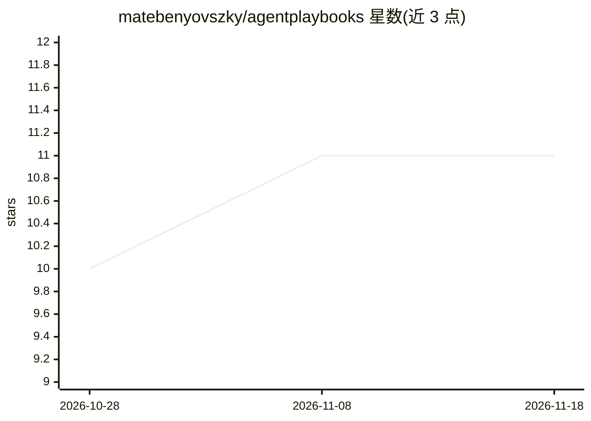

# matebenyovszky/agentplaybooks

⭐ 11 · TypeScript · MIT · 推送 2026-11-16 · [GitHub](https://github.com/matebenyovszky/agentplaybooks) · [官网](https://agentplaybooks.ai/) · 个人维护

**AI agent 配置的可移植 playbook：一处存储，多平台同步**

将 AI agent 的人设、技能（SKILL.md）、MCP 服务器、项目指令与记忆集中存储为可移植 playbook，通过 CLI 同步到 Claude Code、Cursor、ChatGPT/Codex、Gemini CLI 等多个宿主，避免绑定单一平台。核心机制包括：AES-256-GCM 秘密保管库（服务端注入、强制过期）、联邦工具接入、审计哈希链与 JSONL/CSV 导出、Canvas 版本化工作文档、基于 Next.js 16 + Supabase + Cloudflare Workers 的自托管部署。

## 筛选速览

| 维度 | 判定 | 备注 |
|---|---|---|
| AI 角色 | `ai-ecosystem` | LLM/agent 周边工具 |
| 许可风险 | `permissive` | MIT |
| 部署形态 | `library` | 以包/库形式分发 |
| 模型依赖 | locked-api |  |
| 硬件要求 | — | 无带数字的原话,不猜 |
| 安装摩擦 | `low` | 无编译、无系统依赖或容器化 |
| 成熟度 | — | 结构信号不足 |

## 能力要点

- playbook 聚合 persona、技能、MCP、指令与记忆，跨平台同步
- 秘密保管库：AES-256-GCM 加密、服务端注入、强制过期与主机白名单
- 审计链路：SHA-256 哈希链、append-only 历史、JSONL/CSV 导出与 CLI 验证
- CLI 支持 doctor 检查与 sync 到多宿主，插件导出 Agent Plugins 1.0 格式

## 适用场景

- 在 Claude、Cursor、Codex 等多个平台间保持 agent 配置一致
- 自托管管理 agent 凭据并留存可验证审计证据
- 团队协作共享 playbook，用角色权限控制访问
- 导出插件包将同一套技能部署到不同 agent 宿主

## 场景标签

`提示工程` · 领域:Agent 开发

## 证据(README 行号)

> L3: **One playbook, every agent.** A portable operating environment for AI agents — persona, skills, MCP servers, projec
> L7: Your agent setup stays in sync across Claude, ChatGPT, Cursor, Codex, Gemini, local models, and future platforms. Th
> L50: - CLI + portable Agent Plugin: audit your local agent config, then sync one playbook

## 星数曲线

2026-10-28 10 → 2026-11-18 11（+1）

---
*卡片 v1 · prompt 1.4 · 生成 2026-11-18 · 置信度 high · 依据 README sha `2d6147fd66d5` · [字段定义](../../DATASET.md)*
