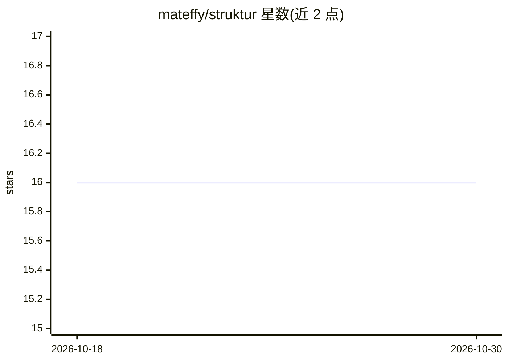

# mateffy/struktur

⭐ 16 · JavaScript · NOASSERTION · 推送 2026-10-05 · [GitHub](https://github.com/mateffy/struktur) · [官网](https://struktur.sh) · 个人维护

**用 LLM 从文档抽取验证后 JSON 的 CLI/SDK 工具**

面向开发者的结构化数据抽取工具：输入 PDF、文本、图片、HTML 等文档，内置解析层将其转为 Artifact JSON，默认由沙箱化 Agent 策略自主探索文档并抽取，每次 LLM 响应按 JSON Schema 验证、失败自动重试；另提供 simple/parallel/sequential/doublePass 等 8 种抽取策略，支持分块、合并与去重，以及 fields 简写语法定义模式。多供应商开箱支持（OpenAI、Anthropic、Mistral、OpenRouter 等），可通过 npm/bun 全局安装 CLI，另提供 TypeScript SDK 与自定义解析器扩展机制。

## 筛选速览

| 维度 | 判定 | 备注 |
|---|---|---|
| AI 角色 | `ai-native` | 本体是模型或模型工具 |
| 许可风险 | `none` | NOASSERTION |
| 部署形态 | `library` | 以包/库形式分发 |
| 模型依赖 | locked-api |  |
| 硬件要求 | — | 无带数字的原话,不猜 |
| 安装摩擦 | `low` | 无编译、无系统依赖或容器化 |
| 成熟度 | — | 结构信号不足 |

## 能力要点

- 内置解析层将 PDF/文本/图片转为 Artifact JSON，无需手动转换
- 默认 Agent 策略在进程内沙箱中自主探索文档抽取数据
- 每个 LLM 响应按 JSON Schema 验证，失败自动回传重试
- 8 种抽取策略覆盖小输入、大文档分块、去重合并与两遍精炼

## 适用场景

- 从发票、合同等 PDF 中抽取指定字段得到验证后的 JSON
- 在管道中用 stdin/URL 流式输入做批量结构化抽取
- 为不支持的可扩展自定义解析器并构建缓存管道

## 场景标签

`文档解析` · 领域:知识与检索

## 证据(README 行号)

> L7:  All-in-one tool for structured data extraction using LLMs. Feed it documents, get back validated JSON. Handles pars
> L117: Struktur converts input files into **Artifacts** — normalized JSON with text and media slices. The **Agent** then 
> L133: The agent decides how to approach extraction based on your schema and the document content. It may read the entire

## 星数曲线

2026-10-18 16 → 2026-10-30 16（+0）

---
*卡片 v1 · prompt 1.4 · 生成 2026-10-30 · 置信度 high · 依据 README sha `70a2f6ee7d09` · [字段定义](../../DATASET.md)*
