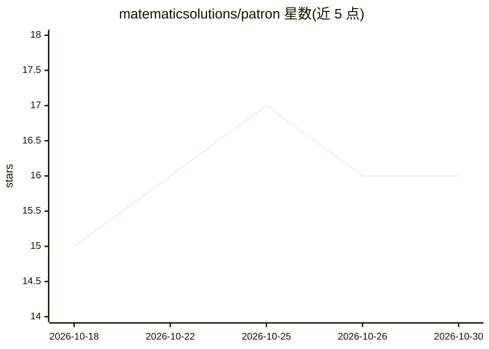

# matematicsolutions/patron

⭐ 16 · TypeScript · AGPL-3.0 · 推送 2026-10-26 · [GitHub](https://github.com/matematicsolutions/patron) · [官网](https://matematicsolutions.com) · 组织维护

**律所本地优先的 AI 工作台：卷宗留在本机，自带可验证审计链**

面向单一律师的单用户 Electron 桌面应用：案卷默认存本地 SQLite，提供对案卷文件的对话（引用带绿/黄/红核验标记）、批量合同表格审查、Word 修订式编辑、文书起草等能力。内置 20 个 MCP 连接器（波兰与欧盟法律源及 13 国 ELI 立法源）加离线 EU 合规语料。模型自选：本地 Ollama 或 Gemini/Claude/OpenRouter 自带 key，调用云端前先做人名与标识符脱敏。每次模型交互写入哈希链审计链，导出 ZIP 自带浏览器与 Python 校验器。明确不做的：多人共享服务器、匿名化保证、合规认证等。

## 筛选速览

| 维度 | 判定 | 备注 |
|---|---|---|
| AI 角色 | `ai-native` | 本体是模型或模型工具 |
| 许可风险 | `dual` | AGPL-3.0 |
| 部署形态 | `library` | 以包/库形式分发 |
| 模型依赖 | local-ok | 支持本地模型 |
| 硬件要求 | — | 无带数字的原话,不猜 |
| 安装摩擦 | `low` | 无编译、无系统依赖或容器化 |
| 成熟度 | — | 结构信号不足 |

## 能力要点

- 20 个波兰/欧盟/各国法律源 MCP 连接器 + 离线 EU 合规语料（GDPR/AI Act/DORA 等）
- 哈希链 + Merkle 根审计链，导出包自带第三方可独立运行的校验器
- 云端调用前对姓名、公司、PESEL/NIP/REGON 脱敏，并有出站流量守卫
- 9 个司法辖区安装版（PL/EN/US/GB/BR/IT/DE/ES/FR），基于 Mike（AGPL-3.0）分叉并加波兰本地化

## 适用场景

- 律师在本机对案卷文件做带引用核验的问答与合同批量审查
- 以 Word 修订模式审阅 AI 提出的文档修改并逐条接受/拒绝
- 在满足 AI Act art. 12 记录义务的场景下留存的模型交互审计链

## 场景标签

`文档问答` `AI 写作` · 领域:内容生成

## 证据(README 行号)

> L11: > **A local-first, self-hosted AI workspace for a law firm.** A single-user desktop
> L53: - **Bring your own model** - a local Ollama model, or Gemini, Claude or OpenRouter with your own key,

## 星数曲线

2026-10-18 15 → 2026-10-30 16（+1）

---
*卡片 v1 · prompt 1.4 · 生成 2026-10-30 · 置信度 high · 依据 README sha `7ceb2a6f0141` · [字段定义](../../DATASET.md)*
