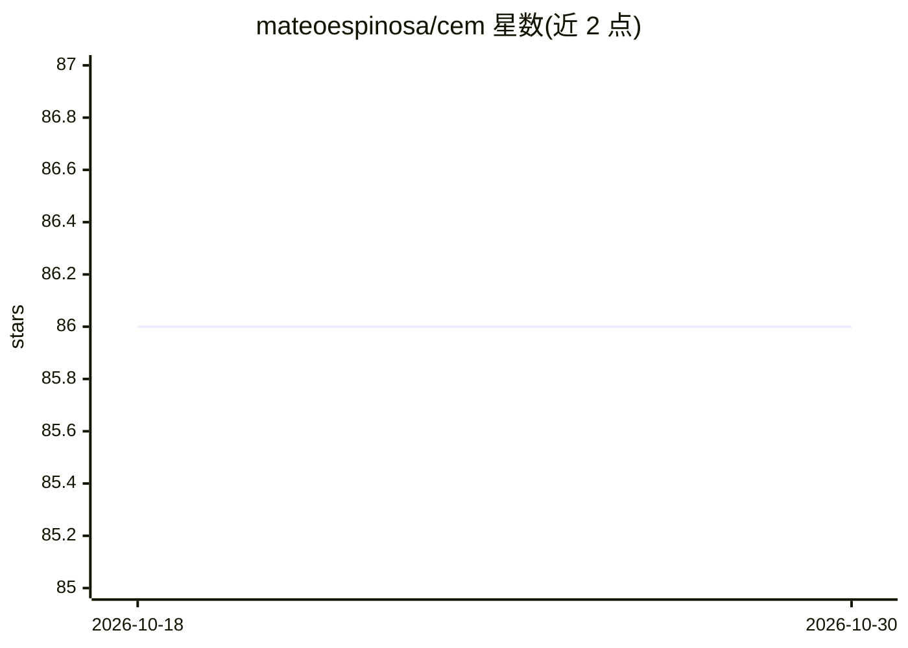

# mateoespinosa/cem

⭐ 86 · Python · MIT · 推送 2026-04-05 · [GitHub](https://github.com/mateoespinosa/cem) · [官网](https://arxiv.org/abs/2209.09056) · 个人维护

**概念瓶颈/概念嵌入可解释神经网络模型族的 PyTorch 官方实现**

三篇论文（NeurIPS 2022 CEM、NeurIPS 2023 IntCEM、ICML 2025 MixCEM）的官方 PyTorch 实现，面向可解释 AI 研究者。核心是概念嵌入模型（CEM）：为每个概念学习高维 active/inactive 两个嵌入，允许未标注概念的信息通过瓶颈，同时保留测试时人工概念干预能力；IntCEM 增加干预感知训练策略，MixCEM 解决分布偏移下的 leakage poisoning。仓库还实现 CBM、Hybrid CBM、ProbCBM、PCBM 等基线与标准 DNN，通过 git clone 与 setup.py 安装。README 未见 pip 发布与 Docker 说明。

## 筛选速览

| 维度 | 判定 | 备注 |
|---|---|---|
| AI 角色 | `ai-native` | 本体是模型或模型工具 |
| 许可风险 | `permissive` | MIT |
| 部署形态 | `None` |  |
| 模型依赖 | — | README 未给出锁定关系 |
| 硬件要求 | — | 无带数字的原话,不猜 |
| 安装摩擦 | `low` | 无编译、无系统依赖或容器化 |
| 成熟度 | — | 结构信号不足 |

## 能力要点

- 实现 7+ 种概念瓶颈类模型（CEM/IntCEM/MixCEM/CBM/ProbCBM/PCBM 等）
- CEM 每概念学习 active/inactive 双嵌入，兼顾性能与测试时概念干预
- IntCEM 端到端学习概念干预策略
- 支持 binary/fuzzy/unbounded 概念瓶颈与残差版 PCBM

## 适用场景

- 复现三篇论文的实验结果
- 对比研究概念可解释模型与标准黑盒 DNN
- 构建支持人机协同概念干预的可解释分类系统

## 场景标签

`模型训练` `模型评测` · 领域:评测与运维

## 证据(README 行号)

> L4: This repository contains the official Pytorch implementation of our three papers:
> L40: We propose **Concept Embedding Models (CEMs)**, a novel family of concept-based

## 星数曲线

2026-10-18 86 → 2026-10-30 86（+0）

---
*卡片 v1 · prompt 1.4 · 生成 2026-10-24 · 置信度 high · 依据 README sha `fe601330d899` · [字段定义](../../DATASET.md)*
