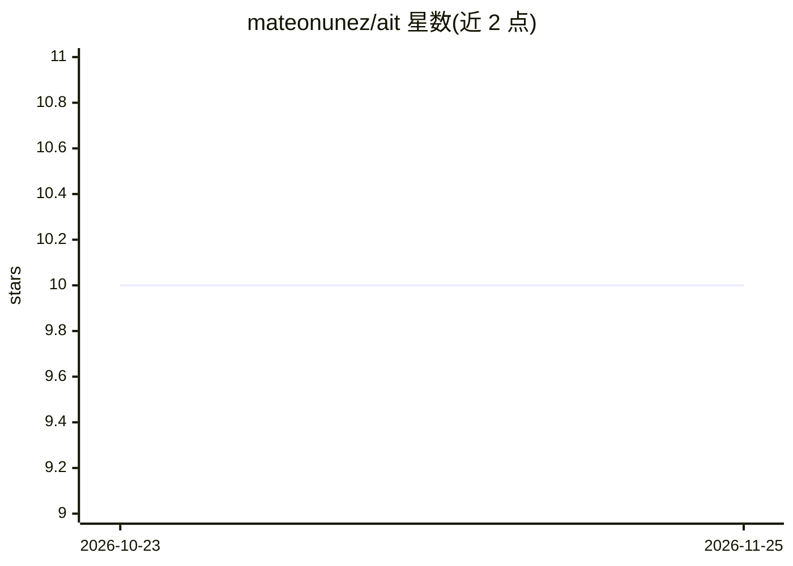

# mateonunez/ait

⭐ 10 · TypeScript · MIT · 推送 2026-01-25 · [GitHub](https://github.com/mateonunez/ait) · [官网](https://ait.chat) · 个人维护

**自托管个人数据 AI 平台：接入多来源数据做 RAG 问答**

一个 monorepo 结构的自托管平台，通过 OAuth 2.0 连接 GitHub、Linear、Spotify、Notion、Slack、X、Google 等来源，将个人数据经 ETL 流水线向量化存入 Qdrant，再以 RAG 流水线提供问答与文本生成。AI 能力由 AI SDK 包提供，默认使用 Ollama 本地模型（gemma3、mxbai-embed-large），支持工具调用与 Langfuse 监控。安装方式为 git clone 源码后用 pnpm 与 Docker 启动服务，需配置 PostgreSQL、Redis 等环境变量。

## 筛选速览

| 维度 | 判定 | 备注 |
|---|---|---|
| AI 角色 | `ai-native` | 本体是模型或模型工具 |
| 许可风险 | `permissive` | MIT |
| 部署形态 | `None` |  |
| 模型依赖 | local-ok | 支持本地模型 |
| 硬件要求 | — | 无带数字的原话,不猜 |
| 安装摩擦 | `low` | 无编译、无系统依赖或容器化 |
| 成熟度 | — | 结构信号不足 |

## 能力要点

- 多来源 OAuth 2.0 连接器：GitHub、Linear、Spotify、X、Notion、Slack、Google 等
- Qdrant 向量检索与多集合 RAG 流水线
- Ollama 本地 LLM 用于生成与嵌入
- BullMQ 定时 ETL 与 Langfuse LLM 可观测性

## 适用场景

- 把散落在 Notion、GitHub、Slack 里的个人资料汇总成一个可问答的知识库
- 本地运行模型，避免数据交给第三方 API
- 让 AI agent 通过工具调用查询我已连接的服务

## 场景标签

`RAG` `文档问答` `知识库管理` · 领域:知识与检索

## 证据(README 行号)

> L11: AIt is a comprehensive platform for interacting with your own data with multiple sources compatible (GitHub, Linear
> L60: - **RAG Pipeline**: Multi-collection retrieval-augmented generation
> L46: |**AI SDK**|`packages/infrastructure/ai-sdk`|RAG, text generation, embeddings with Ollama|

## 星数曲线

2026-10-23 10 → 2026-11-25 10（+0）

---
*卡片 v1 · prompt 1.4 · 生成 2026-11-19 · 置信度 high · 依据 README sha `d9c5e2d5f6ed` · [字段定义](../../DATASET.md)*
