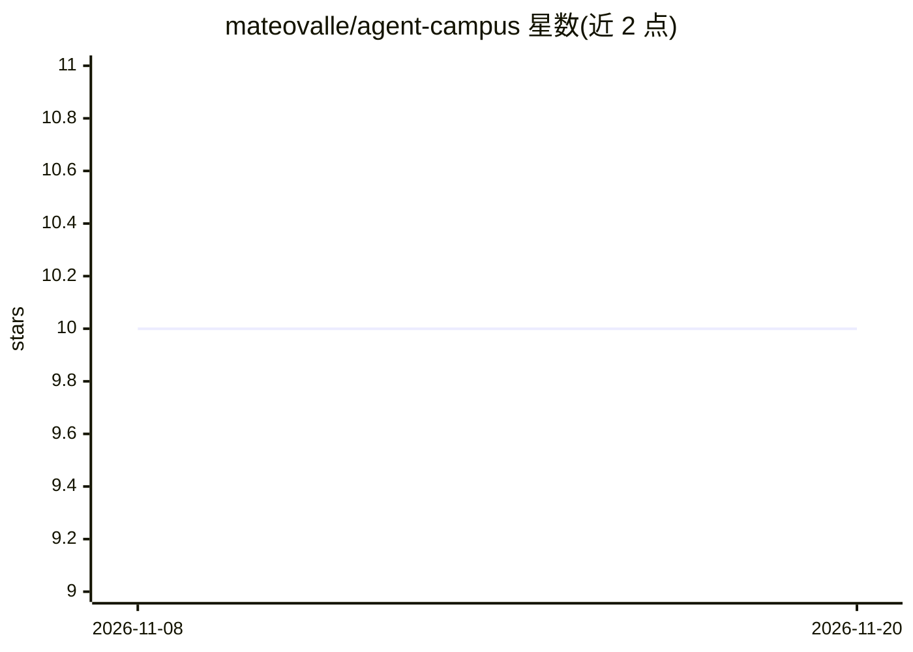

# mateovalle/agent-campus

⭐ 10 · HTML · MIT · 推送 2026-11-16 · [GitHub](https://github.com/mateovalle/agent-campus) · [官网](https://mateovalle.github.io/agent-campus/) · 个人维护

**为 Claude Code agent 提供像素风统一监控与编排的桌面应用**

Electron 桌面应用，把项目文件夹显示为像素地图上的办公室、把 agent 显示为其中的人物，用于统一监控与编排多个 Claude Code agent。基于官方 Claude Agent SDK 提供流式对话、权限模式、任务分派、git worktree 隔离、diff 查看、花费面板与桌面通知。会话为真实 Claude Code 会话，可与终端互通。打包版自带 Claude Code CLI；从源码构建需 Node.js 22+，macOS 安装包未签名需手动放行。

## 筛选速览

| 维度 | 判定 | 备注 |
|---|---|---|
| AI 角色 | `ai-ecosystem` | LLM/agent 周边工具 |
| 许可风险 | `permissive` | MIT |
| 部署形态 | `library` | 以包/库形式分发 |
| 模型依赖 | locked-api |  |
| 硬件要求 | — | 无带数字的原话,不猜 |
| 安装摩擦 | `low` | 无编译、无系统依赖或容器化 |
| 成熟度 | — | 结构信号不足 |

## 能力要点

- 像素画地图上一目了然各项目 agent 的工作与等待状态
- 基于官方 Claude Agent SDK 的富聊天：流式 markdown、工具卡片 diff、权限模式
- git worktree 隔离避免同仓两个 agent 相互覆盖
- 花费面板按 API 牌价逐轮计价，支持单 agent 预算上限

## 适用场景

- 同时管理多个项目里运行的 Claude Code agent
- 一操作多个 agent 分派任务并实时查看改动
- 无人值守运行时用预算上限和桌面通知控制风险

## 场景标签

`编码 Agent` `多智能体` · 领域:Agent 开发

## 证据(README 行号)

> L3: **A pixel-art mission control for your Claude Code agents.** Every project is an office, every agent is a character 
> L10: - 💬 **Rich chat agents** — powered by the official Claude Agent SDK: streamed markdown, tool cards with real diffs,
> L23: Sessions are **real Claude Code sessions** — same login, same config, same transcripts in `~/.claude/projects`. Sta

## 星数曲线

2026-11-08 10 → 2026-11-20 10（+0）

---
*卡片 v1 · prompt 1.4 · 生成 2026-11-19 · 置信度 high · 依据 README sha `664479e09d1c` · [字段定义](../../DATASET.md)*
