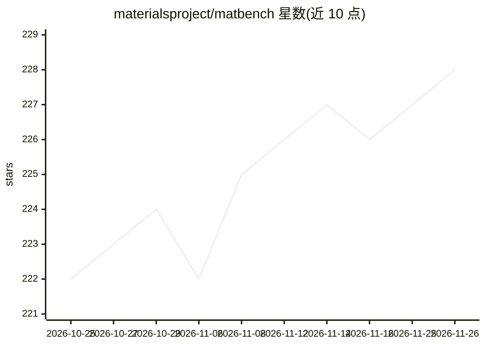

# materialsproject/matbench

⭐ 228 · Python · MIT · 推送 2026-11-25 · [GitHub](https://github.com/materialsproject/matbench) · [官网](https://matbench.materialsproject.org) · 组织维护

**材料科学性质预测的基准任务集与排行榜**

Matbench 提供一组经过整理的材料科学机器学习基准任务（13 个，且计划扩充），用于性质预测方法的性能测试。配套官网排行榜按任务记录分类与回归指标：分类任务同时记录验证过的平衡准确率与概率 ROC AUC，提交结果在五个官方测试折上重新计算。以 Python 包形式发布，pip 可安装，支持 Python 3.8+。附带论文引用信息、文档与完整基准数据下载入口。

## 筛选速览

| 维度 | 判定 | 备注 |
|---|---|---|
| AI 角色 | `ai-knowledge` | 知识聚合/清单类 |
| 许可风险 | `permissive` | MIT |
| 部署形态 | `library` | 以包/库形式分发 |
| 模型依赖 | — | README 未给出锁定关系 |
| 硬件要求 | — | 无带数字的原话,不猜 |
| 安装摩擦 | `low` | 无编译、无系统依赖或容器化 |
| 成熟度 | — | 结构信号不足 |

## 能力要点

- 13 个整理好的材料性质预测基准任务
- 分任务排行榜，分类指标同时采用平衡准确率与概率 ROC AUC
- 提交结果对照官方测试标签在五折上重新计算
- 提供完整基准数据与文档

## 适用场景

- 比较不同材料性质预测模型在统一任务集上的表现
- 为新提出的机器学习算法获取可复现的基准评测
- 下载基准数据开展材料机器学习研究

## 场景标签

`模型评测` · 领域:评测与运维

## 证据(README 行号)

> L3: matbench is an ImageNet for materials science; a set of 13 (with more to come!) curated machine learning tasks for b
> L29: Matbench is pip installable! Install with `pip install matbench` or see the installation page for more details.

## 星数曲线

2026-10-25 222 → 2026-11-26 228（+6）

---
*卡片 v1 · prompt 1.4 · 生成 2026-11-25 · 置信度 high · 依据 README sha `bb9aac41cd3b` · [字段定义](../../DATASET.md)*
