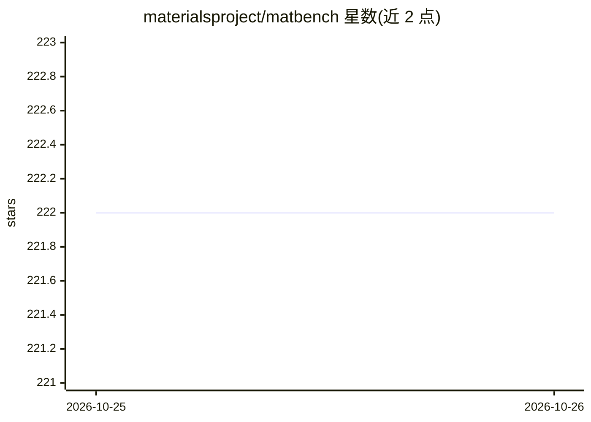

# materialsproject/matbench

⭐ 222 · Python · MIT · 推送 2026-10-24 · [GitHub](https://github.com/materialsproject/matbench) · [官网](https://matbench.materialsproject.org) · 组织维护

**材料科学性质预测的基准测试任务集（13 个任务）**

提供 13 个经筛选的机器学习任务，用于材料科学性质预测方法的基准测试与性能评估，配套排行榜、分任务排行榜、完整基准数据与代码参考。发布论文于 npj Computational Materials（2020）。以 Python 包形式发布，支持 Python 3.8+，通过 pip 安装。README 载有 matbench_v0.1 分类任务 ROC-AUC 分数的计算更正说明：旧排行榜分数基于 0.5 阈值化预测，等于平衡准确率而非真实 ROC-AUC，未来评分已修复但既有分数未重算。

## 筛选速览

| 维度 | 判定 | 备注 |
|---|---|---|
| AI 角色 | `ai-ecosystem` | LLM/agent 周边工具 |
| 许可风险 | `permissive` | MIT |
| 部署形态 | `library` | 以包/库形式分发 |
| 模型依赖 | — | README 未给出锁定关系 |
| 硬件要求 | — | 无带数字的原话,不猜 |
| 安装摩擦 | `low` | 无编译、无系统依赖或容器化 |
| 成熟度 | — | 结构信号不足 |

## 能力要点

- 13 个经筛选的材料科学 ML 基准任务
- 提供总榜与分任务排行榜及完整基准数据
- 配套论文发表于 npj Computational Materials (2020)
- pip 安装，支持 Python 3.8+

## 适用场景

- 评估和比较材料性质预测的机器学习模型
- 查阅各任务上的公开排行榜成绩
- 为材料科学研究挑选可复现的基准数据

## 场景标签

`模型评测` · 领域:评测与运维

## 证据(README 行号)

> L3: matbench is an ImageNet for materials science; a set of 13 (with more to come!) curated machine learning tasks for b
> L24: Dunn, A., Wang, Q., Ganose, A., Dopp, D., Jain, A. Benchmarking Materials Property

## 星数曲线

2026-10-25 222 → 2026-10-26 222（+0）

---
*卡片 v1 · prompt 1.4 · 生成 2026-10-24 · 置信度 high · 依据 README sha `815fb6ea0498` · [字段定义](../../DATASET.md)*
