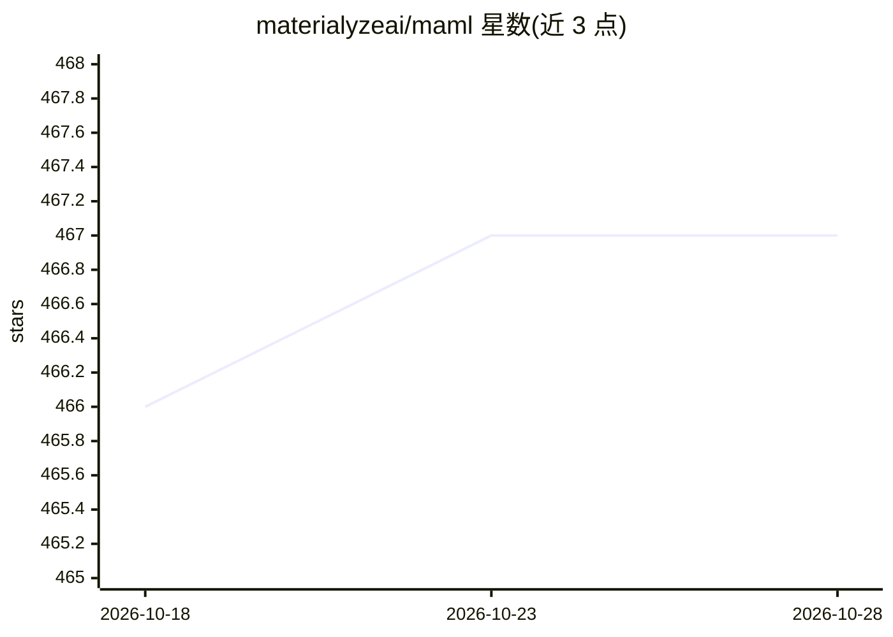

# materialyzeai/maml

⭐ 467 · Jupyter Notebook · BSD-3-Clause · 推送 2026-10-26 · [GitHub](https://github.com/materialyzeai/maml) · 组织维护

**材料科学机器学习 Python 库：材料特征、力场与性质预测**

面向材料科学研究的 Python 包，提供将晶体/分子转换为特征（Bispectrum、Behler-Parrinello、SOAP、图网络特征等）的高层接口，并基于 scikit-learn/keras 学习特征与目标的关系。应用模块包括 pes（势能面建模，支持 NNP/GAP/SNAP/MTP 等势函数）、rfxas（X 射线吸收谱预测原子局域环境）和 bowsr（贝叶斯优化加速结构弛豫）。实现依赖既有包（pymatgen、matminer 等），运行 pes 需额外安装 LAMMPS。通过 PyPI 安装。

## 筛选速览

| 维度 | 判定 | 备注 |
|---|---|---|
| AI 角色 | `ai-native` | 本体是模型或模型工具 |
| 许可风险 | `permissive` | BSD-3-Clause |
| 部署形态 | `library` | 以包/库形式分发 |
| 模型依赖 | — | README 未给出锁定关系 |
| 硬件要求 | — | 无带数字的原话,不猜 |
| 安装摩擦 | `low` | 无编译、无系统依赖或容器化 |
| 成熟度 | — | 结构信号不足 |

## 能力要点

- 提供 Bispectrum/Behler-Parrinello/SOAP/图网络等多种材料特征
- 势能面模块支持 NNP、GAP、SNAP、MTP 四类机器学习势
- rfxas 用随机森林从 X 射线吸收谱预测原子局域环境
- bowsr 以贝叶斯优化加代理能量模型做快速结构弛豫

## 适用场景

- 为晶体/分子数据生成描述符并训练性质预测模型
- 拟合机器学习原子间势做势能面建模
- 从 XAS 谱预测原子局域环境
- 用贝叶斯优化加速晶体结构弛豫

## 场景标签

 · 领域:材料科学/机器学习

## 证据(README 行号)

> L9: maml (MAterials Machine Learning) is a Python package that aims to provide useful high-level interfaces that make ML
> L29: 2. Use ML to learn relationship between features and targets. Currently, the `maml` supports `sklearn` and `keras`
> L34:  a) `pes` for modelling the potential energy surface, constructing surrogate models for property prediction.

## 星数曲线

2026-10-18 466 → 2026-10-28 467（+1）

---
*卡片 v1 · prompt 1.4 · 生成 2026-10-21 · 置信度 high · 依据 README sha `9c3b184c8334` · [字段定义](../../DATASET.md)*
