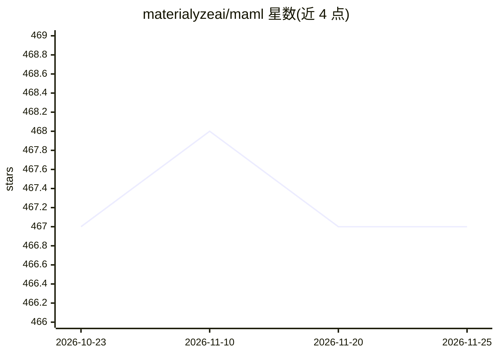

# materialyzeai/maml

⭐ 467 · Python · BSD-3-Clause · 推送 2026-11-17 · [GitHub](https://github.com/materialyzeai/maml) · 组织维护

**材料科学机器学习 Python 库：描述符、势函数与建模接口**

maml 为材料科学机器学习提供高层接口，本身不重新实现 ML 算法，而是封装 scikit-learn、TensorFlow 与 MatGL 作为模型后端，pymatgen 与 matminer 处理结构与特征化。模块覆盖材料描述符、ML 势函数拟合（SNAP/GAP/MTP/NNP，需外部代码 LAMMPS 等另行安装）、BOWSR 贝叶斯优化结构弛豫、晶界能模型与符号回归。通过 pip 安装，提供文档、示例 notebook 与引用文献。

## 筛选速览

| 维度 | 判定 | 备注 |
|---|---|---|
| AI 角色 | `ai-native` | 本体是模型或模型工具 |
| 许可风险 | `permissive` | BSD-3-Clause |
| 部署形态 | `library` | 以包/库形式分发 |
| 模型依赖 | — | README 未给出锁定关系 |
| 硬件要求 | — | 无带数字的原话,不猜 |
| 安装摩擦 | `low` | 无编译、无系统依赖或容器化 |
| 成熟度 | — | 结构信号不足 |

## 能力要点

- 描述符模块支持元素统计、SOAP、bispectrum、MEGNet/M3GNet 图嵌入等
- 拟合与评估 ML 原子间势（SNAP/qSNAP、GAP、MTP、NNP）并接 LAMMPS 性质计算
- BOWSR 以代理能量模型做无 DFT 结构弛豫
- DIRECT 采样模块用于筛选多样化训练集

## 适用场景

- 从化学组成或晶体结构生成机器学习特征向量
- 训练并评估机器学习原子间势用于材料性质计算
- 用贝叶斯优化替代 DFT 做结构弛豫
- 小样本材料数据集的迁移学习建模

## 场景标签

`科研工具` · 领域:学习与行业

## 证据(README 行号)

> L9: maml (MAterials Machine Learning) provides high-level interfaces that make machine learning for materials science as
> L24: |`maml.describers`|Convert compositions, sites and structures into features: element statistics, Coulomb matrices, 
> L27: |`maml.apps.pes`|Fit and evaluate machine-learning interatomic potentials: SNAP/qSNAP, GAP, MTP and NNP, with LAMMP

## 星数曲线

2026-10-23 467 → 2026-11-25 467（+0）

---
*卡片 v1 · prompt 1.4 · 生成 2026-11-25 · 置信度 high · 依据 README sha `7ff59bb69a70` · [字段定义](../../DATASET.md)*
