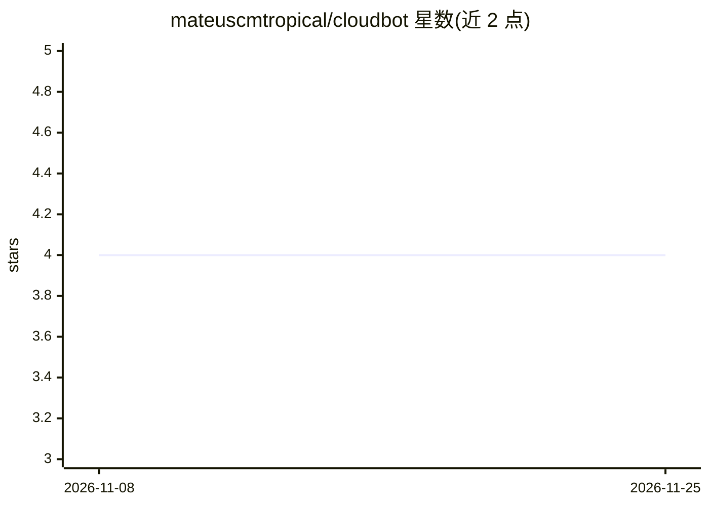

# mateuscmtropical/cloudbot

⭐ 4 · TypeScript · MIT · 推送 2026-11-18 · [GitHub](https://github.com/mateuscmtropical/cloudbot) · 个人维护

**VPS 上的常驻 AI 同事：托管各家 AI CLI 替你干活**

自托管在 VPS 上的多 bot 平台：每个 bot 运行用户自选 AI 提供商的官方 CLI（用自己的订阅或 API key），通过网页聊天下达任务，bot 在独立 Linux 桌面（浏览器/终端/应用）中自动操作，完成后回报。规划能力包括密码保管库、敏感操作审批、定时任务与事件触发、WhatsApp/Telegram/Discord 通道、技能学习、72 应用接入。README 标注项目处于早期开发、尚不可用，通过 Docker 一键脚本安装于 Debian/Ubuntu 或 Windows（WSL2）。

## 筛选速览

| 维度 | 判定 | 备注 |
|---|---|---|
| AI 角色 | `ai-native` | 本体是模型或模型工具 |
| 许可风险 | `permissive` | MIT |
| 部署形态 | `library` | 以包/库形式分发 |
| 模型依赖 | — | README 未给出锁定关系 |
| 硬件要求 | — | 无带数字的原话,不猜 |
| 安装摩擦 | `medium` | 含编译或系统依赖之一 |
| 成熟度 | `idea` | |

## 能力要点

- 每个 bot 可绑定不同 AI 提供商的官方 CLI，用用户自己的订阅或 API key
- bot 拥有独立 Linux 桌面，可点击、输入、截屏操作任意应用
- 密码经保管库注入，bot 使用但无法读取；敏感操作前有审批步骤
- 支持定时任务、事件触发、Webhook 唤醒与每日简报

## 适用场景

- 在 VPS 上托管多个 AI bot 长时间替我执行任务
- 让 AI 加入 Google Meet 做会议记录与转录
- 通过 WhatsApp/Telegram/Discord 远程给 bot 下指令
- 让 bot 在网页上代我操作并遇到验证码时交还屏幕

## 场景标签

`AI 助手` `浏览器自动化` `GUI 自动化` `聊天机器人` · 领域:效率与自动化

## 证据(README 行号)

> L5: Your own always-on AI coworker, running on your VPS on the AI subscription or API key you choose.
> L17: > It runs each provider's official CLI, with your own subscription or your own
> L90: - **Work on its own computer.** A whole Linux desktop of its own, with a

## 星数曲线

2026-11-08 4 → 2026-11-25 4（+0）

---
*卡片 v1 · prompt 1.4 · 生成 2026-11-21 · 置信度 mid · 依据 README sha `5845f0fd4fb7` · [字段定义](../../DATASET.md)*
