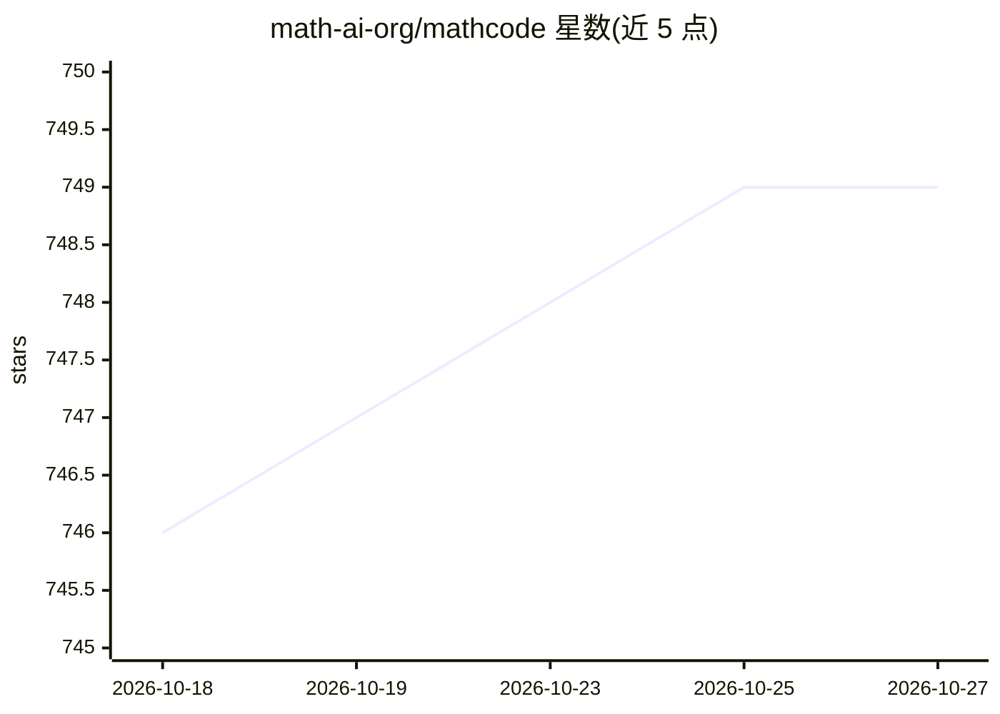

# math-ai-org/mathcode

⭐ 749 · Shell · Apache-2.0 · 推送 2026-10-06 · [GitHub](https://github.com/math-ai-org/mathcode) · [官网](https://math-ai-org.github.io/mathcode) · 组织维护 · 中文 README

**面向数学证明的编码 Agent：终端/WebUI 中写 Lean 4 证明**

MathCode 是一个运行于终端和浏览器的编码助手，内置 Lean 4 支持：可查看证明目标、搜索声明、检查候选证明并验证已完成的证明。Lean 作为证明权威，证明仅在严格验证通过后才算完成；定理库存储与 vault 更新为显式操作。支持在工作区中处理代码与 Lean 证明，可将已验证定理与显式假设存入 Obsidian，并支持项目技能、Python 分析工具与 MCP 插件。默认后端需 codex CLI 与 Codex 登录；支持 macOS Apple Silicon 与 Linux x86_64（AVX2），通过 git clone 与 setup.sh 安装。

## 筛选速览

| 维度 | 判定 | 备注 |
|---|---|---|
| AI 角色 | `ai-native` | 本体是模型或模型工具 |
| 许可风险 | `permissive` | Apache-2.0 |
| 部署形态 | `None` |  |
| 模型依赖 | — | README 未给出锁定关系 |
| 硬件要求 | — | 无带数字的原话,不猜 |
| 安装摩擦 | `low` | 无编译、无系统依赖或容器化 |
| 成熟度 | — | 结构信号不足 |

## 能力要点

- 内置 Lean 4：检查证明目标、搜索声明、验证完成证明
- Lean 为证明权威，验证通过才算证明完成
- 本地 WebUI 支持数学与图表渲染
- 支持项目技能、Python 分析工具与 MCP 插件

## 适用场景

- 在自己工作区里写代码与 Lean 证明并由 AI 协助
- 将验证过的定理与假设存入 Obsidian 并探索依赖
- 通过终端 CLI 批量提出证明任务

## 场景标签

`编码 Agent` · 领域:编码与开发

## 证据(README 行号)

> L5: MathCode is a coding assistant for the terminal and browser, with built-in Lean 4
> L23: Lean is the proof authority: a proof is complete only after strict verification

## 星数曲线

2026-10-18 746 → 2026-10-27 749（+3）

---
*卡片 v1 · prompt 1.4 · 生成 2026-10-21 · 置信度 high · 依据 README sha `cf24b33feb9d` · [字段定义](../../DATASET.md)*
