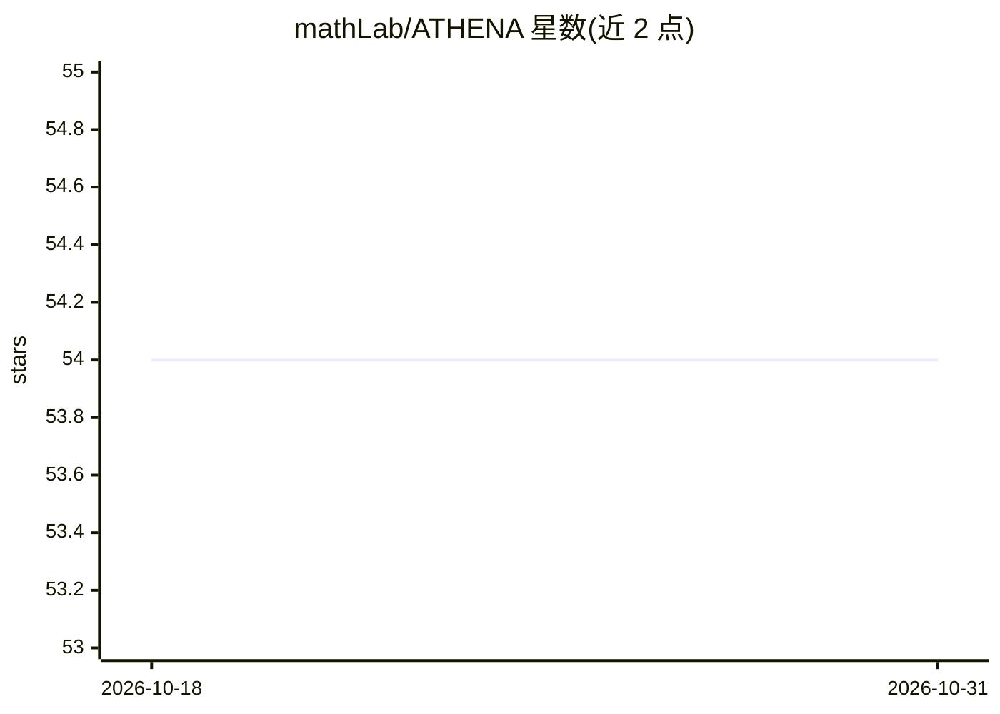

# mathLab/ATHENA

⭐ 54 · Python · MIT · 推送 2026-06-29 · [GitHub](https://github.com/mathLab/ATHENA) · [官网](https://mathlab.github.io/ATHENA/) · 组织维护

**数值分析中高维参数空间降维的 Python 库**

由 SISSA mathLab 开发维护的 Python 包，面向数值分析中的高维参数空间降维，实现 Active Subspaces、Kernel-based Active Subspaces 与 Nonlinear Level-set Learning 等技术。适用于参数化偏微分方程研究、敏感性分析与工程量近似，支持标量与向量高维函数。依赖 numpy、torch、scikit-learn 等，兼容 Python 3.8+，可经 pip 安装或从源码构建，附教程文件夹与 Sphinx 文档，方法均对应已发表论文。

## 筛选速览

| 维度 | 判定 | 备注 |
|---|---|---|
| AI 角色 | `ai-native` | 本体是模型或模型工具 |
| 许可风险 | `permissive` | MIT |
| 部署形态 | `library` | 以包/库形式分发 |
| 模型依赖 | — | README 未给出锁定关系 |
| 硬件要求 | — | 无带数字的原话,不猜 |
| 安装摩擦 | `low` | 无编译、无系统依赖或容器化 |
| 成熟度 | — | 结构信号不足 |

## 能力要点

- 提供 AS / KAS / NLL 三类降维技术实现
- 支持标量与向量高维函数
- 面向参数化 PDE、敏感性分析与工程优化任务
- 附教程、示例与在线文档

## 适用场景

- 参数化 PDE 研究中做参数空间降维
- 高维模型的敏感性分析
- 降低计算密集型优化任务的维度负担

## 场景标签

 · 领域:科学计算/数值分析

## 证据(README 行号)

> L25: **ATHENA** is a Python package for reduction of high dimensional parameter spaces in the context of numerical analy
> L142: **ATHENA** is currently developed and mantained at SISSA mathLab by

## 星数曲线

2026-10-18 54 → 2026-10-31 54（+0）

---
*卡片 v1 · prompt 1.4 · 生成 2026-10-24 · 置信度 high · 依据 README sha `28cbfa658aaa` · [字段定义](../../DATASET.md)*
