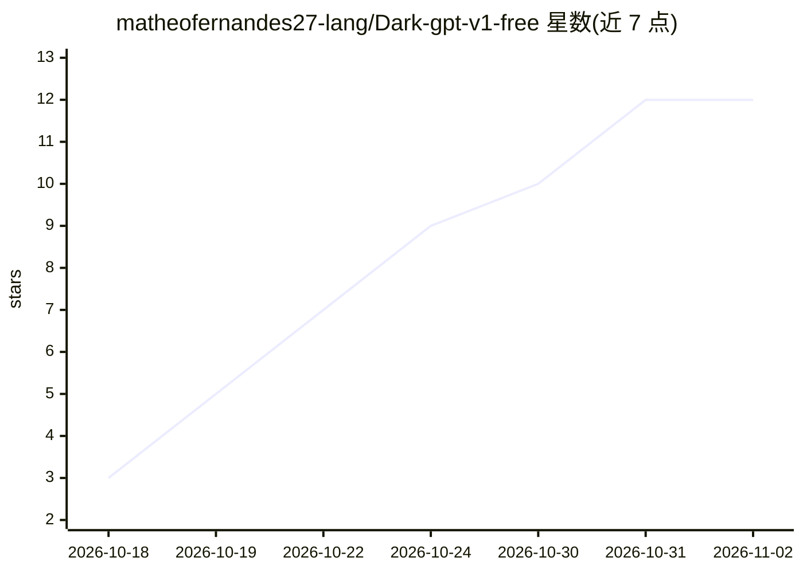

# matheofernandes27-lang/Dark-gpt-v1-free

⭐ 12 · TypeScript · MIT · 推送 2026-09-20 · [GitHub](https://github.com/matheofernandes27-lang/Dark-gpt-v1-free) · [官网](https://dark-gpt-v1-free.vercel.app) · 个人维护

**面向网络安全研究的无限制 AI 对话 CLI 助手**

基于 Python 的命令行工具，通过 OpenAI API 提供绕过常规安全过滤的对话与代码项目管理功能：可创建/编辑/运行代码项目、自动搭建虚拟环境与安装依赖、菜单内切换多种 OpenAI 模型（gpt-3.5-turbo 至 gpt-4-1106-preview）与自定义系统消息，并内置版本更新检查。自称通过 Prompt Engineering 实现，需自备 OpenAI API key；README 明确警告此类用法可能导致 OpenAI 账号被封禁与法律风险，声明仅供教育与研究用途。

## 筛选速览

| 维度 | 判定 | 备注 |
|---|---|---|
| AI 角色 | `ai-native` | 本体是模型或模型工具 |
| 许可风险 | `permissive` | MIT |
| 部署形态 | `None` |  |
| 模型依赖 | — | README 未给出锁定关系 |
| 硬件要求 | — | 无带数字的原话,不猜 |
| 安装摩擦 | `low` | 无编译、无系统依赖或容器化 |
| 成熟度 | — | 结构信号不足 |

## 能力要点

- 通过 OpenAI API 与可编辑系统消息提供无限制对话
- 项目创建/编辑/运行与依赖自动管理
- 菜单内切换 gpt-3.5-turbo / gpt-4-turbo / gpt-4-1106-preview 及自定义模型
- 自动创建虚拟环境并内置版本更新系统

## 适用场景

- 在终端中以自定义系统消息进行网络安全研究对话
- 让 AI 生成并直接运行 Python 代码项目
- 需要可自定义模型与人格的 CLI 聊天工具

## 场景标签

`聊天机器人` `网络安全` · 领域:对话与助手

## 证据(README 行号)

> L15: Dark-GPT is a specialized CLI tool providing unrestricted conversations with AI for cybersecurity research purposes
> L71: 1. **Chat with Dark-GPT**: Start an interactive AI conversation

## 星数曲线

2026-10-18 3 → 2026-11-02 12（+9）

---
*卡片 v1 · prompt 1.4 · 生成 2026-11-01 · 置信度 high · 依据 README sha `bbad267debde` · [字段定义](../../DATASET.md)*
