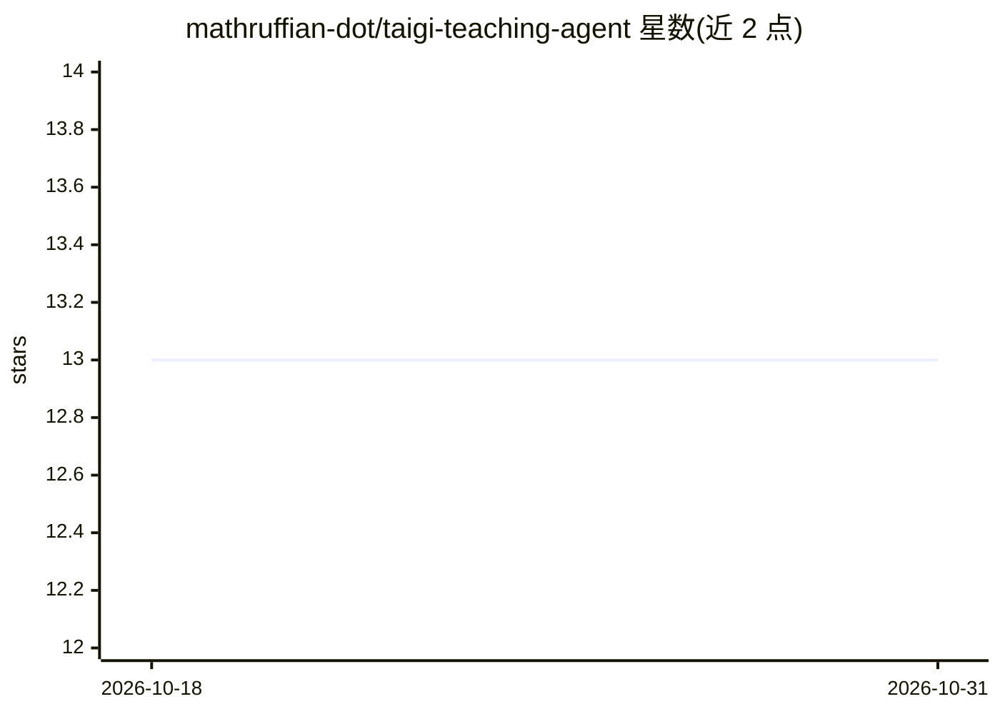

# mathruffian-dot/taigi-teaching-agent

⭐ 13 · Python · NOASSERTION · 推送 2026-09-04 · [GitHub](https://github.com/mathruffian-dot/taigi-teaching-agent) · 个人维护 · 中文 README

**为本土语教师按 108 课纲生成台语教材的 AI Agent**

面向台湾中小学台语教师的整合型教材生成 Agent：教师输入年级、主题与学习目标后，自动生成图片、讲义、测验、离线互动网站、教学影片与语音教材。语音侧串接意传科技媠声免费 TTS（限流每 IP 每分钟 3 句）、教育部官方音檔，本地备援为 facebook/mms-tts-nan（限非商业），并依教育部辞典做汉字与臺羅标音检核；大纲生成可选本机 Ollama＋SARC-Taigi-LLM-12b，缺模型自动降级 Mock。所有生成内容须经教师人工审核才能进入 verified 目录。

## 筛选速览

| 维度 | 判定 | 备注 |
|---|---|---|
| AI 角色 | `ai-native` | 本体是模型或模型工具 |
| 许可风险 | `none` | NOASSERTION |
| 部署形态 | `None` |  |
| 模型依赖 | local-ok | 支持本地模型 |
| 硬件要求 | — | 无带数字的原话,不猜 |
| 安装摩擦 | `medium` | 含编译或系统依赖之一 |
| 成熟度 | — | 结构信号不足 |

## 能力要点

- 依据 108 课纲与教育部拼音方案自动生成讲义/测验/网站/影片/语音
- 台语 TTS 多引擎：意传媠声＋教育部音檔＋本地 mms-tts-nan 备援
- 汉字→臺羅标音检核以教育部辞典为准
- 统一指令入口 python -m taigi，供 AI Agent 免读源码操作

## 适用场景

- 台语教师按年级与主题快速产出一套配套教材
- 为单句课文生成台语语音与臺羅标音
- 蒐集并分析官方教材建立本地知识库作为生成基础

## 场景标签

`语音合成` `图像生成` · 领域:内容生成

## 证据(README 行号)

> L3: 本專案旨在依據臺灣 108 課綱與教育部規範，為本土語教師打造一個整合型的「臺語教材 AI Agent」。
> L4: 教師輸入教學需求（年級、主題、學習目標等）後，Agent 能夠自動生成圖片、講義、測驗、離線互動網站、教學影片及聲音教材。

## 星数曲线

2026-10-18 13 → 2026-10-31 13（+0）

---
*卡片 v1 · prompt 1.4 · 生成 2026-10-31 · 置信度 high · 依据 README sha `d5a490dcd321` · [字段定义](../../DATASET.md)*
