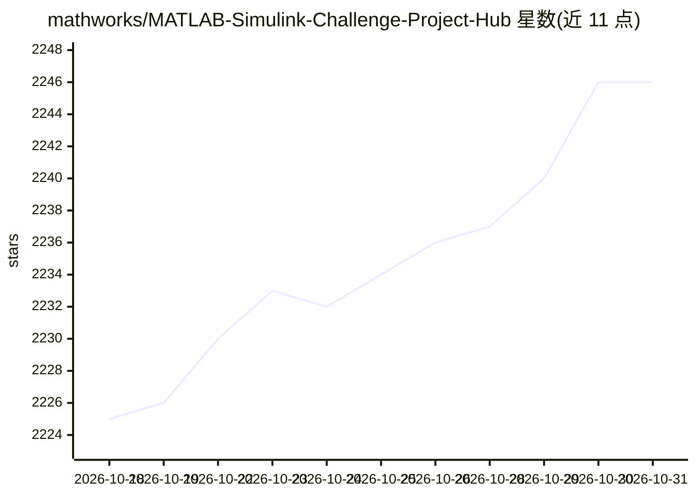

# mathworks/MATLAB-Simulink-Challenge-Project-Hub

⭐ 2,246 · HTML · NOASSERTION · 推送 2026-10-15 · [GitHub](https://github.com/mathworks/MATLAB-Simulink-Challenge-Project-Hub) · 组织维护

**MathWorks 维护的学生挑战项目清单：工科研究/设计课题策展**

由 MathWorks 维护的 MATLAB 与 Simulink 挑战项目清单，面向学生与研究人员提供具有产业关联的研究和设计课题创意。条目按技术趋势（人工智能、自动驾驶、计算机视觉、机器人、无线通信等）组织，每个项目标注影响说明、可习得技能方向、产业合作方与提交情况；完成项目并公开成果可获得 MathWorks 颁发的证书与背书。清单附带交互式项目浏览器，并要求提交者遵守生成式 AI 使用指南，未经核实的 AI 生成内容不被接受。

## 筛选速览

| 维度 | 判定 | 备注 |
|---|---|---|
| AI 角色 | `ai-knowledge` | 知识聚合/清单类 |
| 许可风险 | `none` | NOASSERTION |
| 部署形态 | `None` |  |
| 模型依赖 | — | README 未给出锁定关系 |
| 硬件要求 | — | 无带数字的原话,不猜 |
| 安装摩擦 | `low` | 无编译、无系统依赖或容器化 |
| 成熟度 | — | 结构信号不足 |

## 能力要点

- 按 10 类技术趋势组织的项目课题清单
- 每个条目标注影响、技能方向与产业合作方
- 完成项目可获 MathWorks 证书与研究人员背书
- 附交互式 Project Explorer 过滤工具与生成式 AI 使用准则

## 适用场景

- 为毕业设计/毕业论文寻找有产业背景的课题方向
- 了解 MATLAB/Simulink 相关技术趋势与产业方向
- 通过完成挑战项目获得 MathWorks 官方认证

## 场景标签

`精选清单` · 领域:学习与行业

## 证据(README 行号)

> L8: Explore this list of challenge projects to learn about technology trends, gain practical skills with MATLAB and Simu
> L31: - Artificial Intelligence
> L42: ## All projects :file_folder:

## 星数曲线

2026-10-18 2,225 → 2026-10-31 2,246（+21）

---
*卡片 v1 · prompt 1.4 · 生成 2026-10-21 · 置信度 high · 依据 README sha `866ef3959dc4` · [字段定义](../../DATASET.md)*
