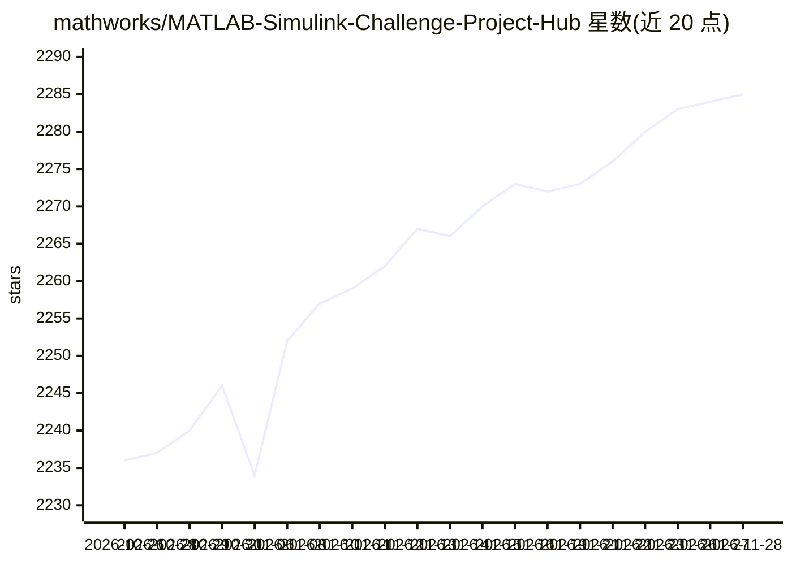

# mathworks/MATLAB-Simulink-Challenge-Project-Hub

⭐ 2,285 · HTML · NOASSERTION · 推送 2026-11-09 · [GitHub](https://github.com/mathworks/MATLAB-Simulink-Challenge-Project-Hub) · 组织维护

**为本科生/研究生提供 MATLAB+Simulink 挑战课题清单**

MathWorks 维护的挑战项目目录，列出带产业背景的设计与研究课题，覆盖 AI、自动驾驶、计算机视觉、无人机、能源、机器人、无线通信等方向。每个条目给出问题描述、影响说明与所需技能，标注行业合作方与提交情况；参与者通过报名表提交意向，开放成果可获得 MathWorks 证书与背书。提交需遵守生成式 AI 使用指南，未经验证的 AI 产出不被接受；课题以 MATLAB/Simulink 工具链为核心。

## 筛选速览

| 维度 | 判定 | 备注 |
|---|---|---|
| AI 角色 | `ai-knowledge` | 知识聚合/清单类 |
| 许可风险 | `none` | NOASSERTION |
| 部署形态 | `None` |  |
| 模型依赖 | — | README 未给出锁定关系 |
| 硬件要求 | — | 无带数字的原话,不猜 |
| 安装摩擦 | `low` | 无编译、无系统依赖或容器化 |
| 成熟度 | — | 结构信号不足 |

## 能力要点

- 按技术趋势分类的挑战课题清单（AI、自动驾驶、CV、能源等 10 类）
- 每个课题标注所需技能、影响与行业合作方
- 提供交互式 Project Explorer 按技术/领域筛选课题
- 完成开放项目可获 MathWorks 证书与背书

## 适用场景

- 为毕业设计或学位论文寻找有产业背景的 MATLAB/Simulink 课题
- 通过完成挑战项目获得 MathWorks 的证书与认可
- 按技术方向筛选适合自己技能积累的项目

## 场景标签

`教程课程` `精选清单` · 领域:学习与行业

## 证据(README 行号)

> L6: Are you looking for a design or research project idea with real industry relevance and societal impact?
> L30: ## Projects by technology trends :file_cabinet:
> L31: - Artificial Intelligence

## 星数曲线

2026-10-26 2,236 → 2026-11-28 2,285（+49）

---
*卡片 v1 · prompt 1.4 · 生成 2026-11-23 · 置信度 high · 依据 README sha `85e5d2103008` · [字段定义](../../DATASET.md)*
