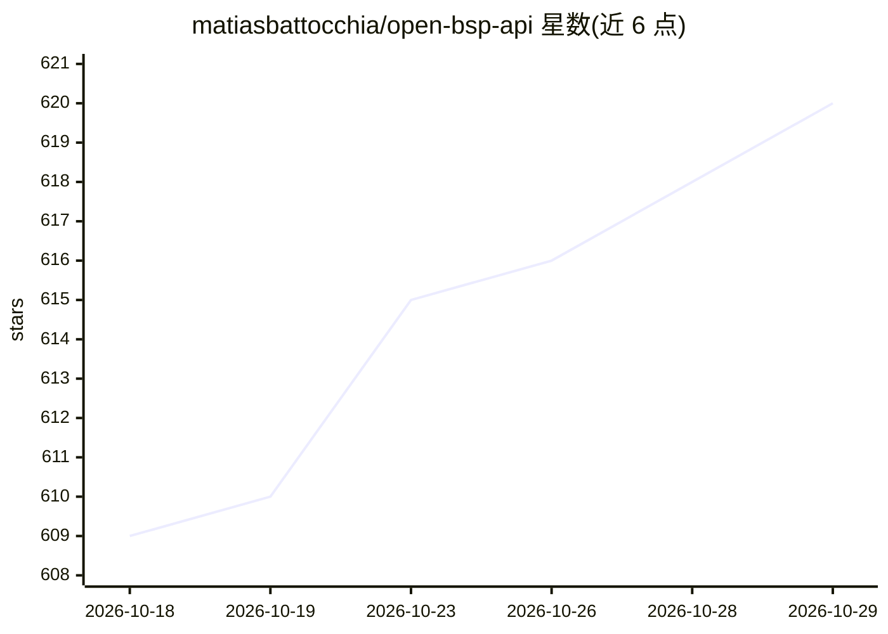

# matiasbattocchia/open-bsp-api

⭐ 620 · TypeScript · Unlicense · 推送 2026-10-28 · [GitHub](https://github.com/matiasbattocchia/open-bsp-api) · [官网](https://web.openbsp.dev) · 个人维护

**可自托管的多租户 WhatsApp/Instagram 商业消息平台，支持 AI agent 接入**

用 Deno 与 Postgres 构建、依托 Supabase 的开源 WhatsApp 与 Instagram Business 平台：通过官方 Meta API 收发消息并存入 Supabase 数据库，API 以 PostgREST 形式暴露（每张表即端点），支持 webhook 外发事件。面向个体商户与服务商，可用于自有消息管理或转型为 Meta Business Partner。AI 部分：可创建轻量 agent（内置 MCP/SQL/HTTP 客户端等工具，支持 chat-completions、responses 协议）或外接高级 agent；另提供 MCP Edge Function、n8n 节点与 Claude Code 插件。提供托管版与 15 分钟自托管部署路径。

## 筛选速览

| 维度 | 判定 | 备注 |
|---|---|---|
| AI 角色 | `ai-enhanced` | 去掉 AI 部分产品仍成立 |
| 许可风险 | `permissive` | Unlicense |
| 部署形态 | `library` | 以包/库形式分发 |
| 模型依赖 | — | README 未给出锁定关系 |
| 硬件要求 | — | 无带数字的原话,不猜 |
| 安装摩擦 | `low` | 无编译、无系统依赖或容器化 |
| 成熟度 | — | 结构信号不足 |

## 能力要点

- 多租户架构，组织间数据隔离
- 通过 MCP Edge Function 向 Claude Code、ChatGPT 等客户端暴露 WhatsApp API 工具
- 轻量 agent 内置 MCP 客户端、SQL 客户端、HTTP 客户端、计算器工具
- 托管版与自托管版同 schema，组织数据可导出迁移

## 适用场景

- 自托管收发 WhatsApp/Instagram 消息并用 REST/Supabase SDK 集成到自己的系统
- 让 Claude Code 或 ChatGPT 通过 MCP 直接查询会话并发送 WhatsApp 消息
- 从 Twilio 或 whatsapp-web.js 迁移既有 WhatsApp 集成

## 场景标签

`Agent 框架` · 领域:Agent 开发

## 证据(README 行号)

> L151: OpenBSP API is a multi-tenant platform that connects to the official WhatsApp
> L169: Create lightweight agents or connect to external, more advanced agents using
> L180: > This project prioritizes a decoupled architecture between communication and

## 星数曲线

2026-10-18 609 → 2026-10-29 620（+11）

---
*卡片 v1 · prompt 1.4 · 生成 2026-10-21 · 置信度 mid · 依据 README sha `a79ad665bfcc` · [字段定义](../../DATASET.md)*
